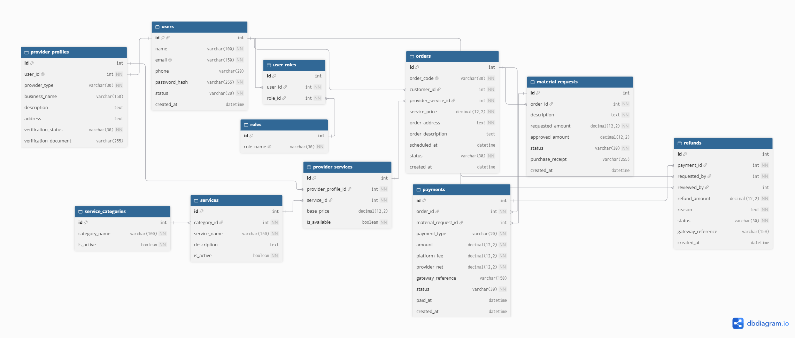

# Dokumentasi ERD Database Jasa Kita

## 1. Pendahuluan

Dokumen ini menjelaskan rancangan *Entity Relationship Diagram* (ERD) untuk aplikasi **Jasa Kita**. ERD digunakan sebagai acuan dalam perancangan database agar struktur penyimpanan data dan hubungan antartabel dapat dipahami oleh seluruh anggota tim pengembangan.

Jasa Kita merupakan aplikasi layanan jasa yang mempertemukan pelanggan (*Customer*) dengan penyedia jasa (*Provider*). Aplikasi ini menyediakan fitur pencarian layanan, pemesanan jasa, pengajuan biaya material, pembayaran, serta pengelolaan pengembalian dana (*refund*).

Rancangan database pada tahap MVP (*Minimum Viable Product*) terdiri dari **11 tabel utama**. Fitur ulasan dan rating belum dimasukkan karena direncanakan untuk pengembangan tahap berikutnya.

## 2. Diagram ERD Database Jasa Kita

Berikut merupakan diagram ERD yang menggambarkan struktur database serta hubungan antartabel pada aplikasi Jasa Kita.

  

## 3. Tujuan Perancangan Database

Perancangan database ini bertujuan untuk:

1. Menyimpan data akun dan hak akses pengguna.
2. Mengelola profil dan informasi verifikasi Provider.
3. Mengelola kategori serta jenis layanan jasa.
4. Menghubungkan Provider dengan layanan yang ditawarkan.
5. Mencatat proses pemesanan jasa oleh Customer.
6. Mencatat pengajuan dan persetujuan biaya material.
7. Mencatat transaksi pembayaran melalui payment gateway.
8. Mengelola permintaan pengembalian dana melalui proses refund.

## 4. Struktur Tabel Database

Database Jasa Kita terdiri dari 11 tabel yang dikelompokkan berdasarkan fungsi masing-masing.

### A. Akun dan Hak Akses

| No. | Nama Tabel | Fungsi |
|---|---|---|
| 1 | `users` | Menyimpan data akun seluruh pengguna yang terdaftar. |
| 2 | `roles` | Menyimpan jenis hak akses, seperti Customer, Provider, dan Admin. |
| 3 | `user_roles` | Menghubungkan akun pengguna dengan hak akses yang dimiliki. |

**Penjelasan:**

Sistem menggunakan satu tabel akun (`users`) untuk seluruh pengguna. Satu akun dapat memiliki lebih dari satu peran, misalnya seseorang dapat menggunakan akun yang sama sebagai Customer sekaligus Provider.

Hubungan antara pengguna dan peran dikelola melalui tabel `user_roles`.

Guest tidak disimpan sebagai akun karena Guest merupakan pengunjung yang belum melakukan login atau registrasi.

### B. Profil Provider

| No. | Nama Tabel | Fungsi |
|---|---|---|
| 4 | `provider_profiles` | Menyimpan informasi tambahan mengenai Provider. |

**Penjelasan:**

Tabel ini menyimpan informasi khusus bagi pengguna yang mendaftar sebagai Provider, seperti jenis Provider (individu atau bisnis), nama usaha, deskripsi layanan, alamat, dokumen verifikasi, dan status verifikasi.

Provider harus melalui proses pemeriksaan oleh Admin sebelum dapat menerima pesanan.

### C. Kategori dan Layanan

| No. | Nama Tabel | Fungsi |
|---|---|---|
| 5 | `service_categories` | Menyimpan kategori layanan jasa. |
| 6 | `services` | Menyimpan jenis layanan berdasarkan kategori. |
| 7 | `provider_services` | Menghubungkan Provider dengan layanan yang ditawarkan beserta harga dasarnya. |

**Penjelasan:**

Kategori digunakan untuk mengelompokkan jenis layanan agar Customer lebih mudah mencari jasa yang dibutuhkan.

Contoh kategori dan layanan:

- Elektronik
  - Perbaikan AC
  - Perbaikan TV
- Rumah Tangga
  - Perbaikan Pipa
  - Jasa Kebersihan
- Kendaraan
  - Servis Motor

Tabel `provider_services` digunakan karena satu Provider dapat menawarkan beberapa layanan, sedangkan satu jenis layanan dapat ditawarkan oleh beberapa Provider.

### D. Pemesanan

| No. | Nama Tabel | Fungsi |
|---|---|---|
| 8 | `orders` | Menyimpan informasi pemesanan jasa yang dilakukan Customer. |

**Penjelasan:**

Tabel `orders` merupakan bagian utama dalam proses transaksi Jasa Kita.

Data yang disimpan meliputi kode pesanan, Customer yang melakukan pemesanan, layanan yang dipilih, harga jasa saat pemesanan, alamat pengerjaan, deskripsi kebutuhan, jadwal, dan status pesanan.

Harga jasa disimpan pada tabel pesanan agar sistem tetap memiliki catatan harga yang disepakati meskipun harga layanan pada profil Provider berubah di kemudian hari.

### E. Pengajuan Material

| No. | Nama Tabel | Fungsi |
|---|---|---|
| 9 | `material_requests` | Menyimpan pengajuan biaya material atau suku cadang yang dibutuhkan untuk menyelesaikan pesanan. |

**Penjelasan:**

Jika Provider membutuhkan material tambahan, Provider dapat mengajukan rincian kebutuhan beserta nominal biayanya kepada Customer.

Customer harus menyetujui pengajuan tersebut sebelum melakukan pembayaran material.

Tabel ini juga menyimpan nominal yang diajukan, nominal yang disetujui, status pengajuan, serta lokasi file bukti pembelian.

### F. Pembayaran

| No. | Nama Tabel | Fungsi |
|---|---|---|
| 10 | `payments` | Mencatat seluruh transaksi pembayaran Customer melalui payment gateway. |

**Penjelasan:**

Jasa Kita menerapkan dua tahap pembayaran:

1. **Pembayaran Material:** dilakukan setelah Customer menyetujui pengajuan biaya material dari Provider.
2. **Pembayaran Jasa:** dilakukan setelah pekerjaan selesai dan Customer mengonfirmasi penyelesaian pesanan.

Kedua pembayaran dicatat sebagai data terpisah dalam tabel `payments`, dengan jenis pembayaran yang dibedakan melalui kolom `payment_type`.

Tabel ini juga menyimpan nominal pembayaran, biaya komisi platform, jumlah bersih Provider, referensi transaksi dari payment gateway, dan status pembayaran.

### G. Refund

| No. | Nama Tabel | Fungsi |
|---|---|---|
| 11 | `refunds` | Menyimpan permintaan pengembalian dana atas transaksi pembayaran. |

**Penjelasan:**

Jika terjadi masalah dalam proses pemesanan atau pembayaran, Customer dapat mengajukan pengembalian dana.

Permintaan refund akan diperiksa oleh Admin berdasarkan alasan, status pesanan, bukti transaksi, dan kondisi terkait lainnya.

Tabel ini mencatat nominal refund, alasan pengajuan, pengguna yang mengajukan, Admin yang memeriksa, status refund, serta referensi transaksi pengembalian dana dari payment gateway.

## 5. Hubungan Antar Tabel

Setiap tabel memiliki hubungan dengan tabel lainnya menggunakan *Primary Key* (PK) dan *Foreign Key* (FK).

### A. Hubungan Akun dan Hak Akses

- `users.id` terhubung dengan `user_roles.user_id`.
- `roles.id` terhubung dengan `user_roles.role_id`.
- `users.id` terhubung dengan `provider_profiles.user_id`.

Satu pengguna dapat memiliki beberapa hak akses. Sementara itu, satu akun dapat memiliki maksimal satu profil Provider.

### B. Hubungan Kategori dan Layanan

- `service_categories.id` terhubung dengan `services.category_id`.
- `services.id` terhubung dengan `provider_services.service_id`.
- `provider_profiles.id` terhubung dengan `provider_services.provider_profile_id`.

Hubungan ini memungkinkan satu kategori memiliki banyak layanan, serta satu Provider menawarkan banyak layanan.

### C. Hubungan Pemesanan

- `users.id` terhubung dengan `orders.customer_id`.
- `provider_services.id` terhubung dengan `orders.provider_service_id`.

Satu Customer dapat membuat banyak pesanan, sedangkan satu pesanan hanya memiliki satu Customer dan satu layanan Provider yang dipilih.

### D. Hubungan Material dan Pembayaran

- `orders.id` terhubung dengan `material_requests.order_id`.
- `orders.id` terhubung dengan `payments.order_id`.
- `material_requests.id` terhubung dengan `payments.material_request_id`.

Satu pesanan dapat memiliki data pengajuan material dan beberapa catatan pembayaran sesuai tahapan transaksi.

Kolom `material_request_id` pada tabel `payments` dapat bernilai kosong untuk pembayaran jasa. Untuk pembayaran material, kolom tersebut mengacu pada pengajuan material terkait.

### E. Hubungan Refund

- `payments.id` terhubung dengan `refunds.payment_id`.
- `users.id` terhubung dengan `refunds.requested_by`.
- `users.id` terhubung dengan `refunds.reviewed_by`.

Satu pembayaran dapat memiliki catatan refund. Pengajuan dilakukan oleh pengguna dan diperiksa oleh Admin.

## 6. Alur Kerja Database Jasa Kita

Berikut gambaran proses penggunaan database dari awal hingga transaksi selesai.

1. **Registrasi dan Login**
   - Pengguna membuat akun.
   - Data akun disimpan pada tabel `users`.
   - Hak akses pengguna disimpan pada tabel `user_roles`.

2. **Registrasi Provider**
   - Pengguna yang ingin menjadi Provider melengkapi profil.
   - Data disimpan pada tabel `provider_profiles`.
   - Admin melakukan pemeriksaan verifikasi.

3. **Pengelolaan Layanan**
   - Admin mengelola kategori dan jenis layanan.
   - Data disimpan pada tabel `service_categories` dan `services`.
   - Provider memilih layanan yang ingin ditawarkan melalui `provider_services`.

4. **Pemesanan Jasa**
   - Customer memilih layanan dan Provider.
   - Sistem menyimpan informasi pesanan pada tabel `orders`.

5. **Pengajuan Biaya Material**
   - Provider mengajukan kebutuhan material.
   - Data disimpan pada tabel `material_requests`.
   - Customer menyetujui atau menolak pengajuan.

6. **Pembayaran Material**
   - Customer membayar biaya material melalui payment gateway.
   - Transaksi dicatat pada tabel `payments`.
   - Provider menunggu konfirmasi pembayaran sebelum membeli material.

7. **Pengerjaan Pesanan**
   - Provider melakukan pekerjaan sesuai pesanan.
   - Provider mengunggah bukti pembelian material jika ada.

8. **Pembayaran Jasa**
   - Setelah pekerjaan selesai, Customer mengonfirmasi penyelesaian.
   - Customer melakukan pembayaran jasa.
   - Transaksi kembali dicatat pada tabel `payments`.

9. **Pengajuan Refund (Jika Diperlukan)**
   - Customer dapat mengajukan refund.
   - Admin melakukan pemeriksaan.
   - Hasil dan status refund dicatat pada tabel `refunds`.

## 7. Ketentuan Penting dalam Pengelolaan Database

Beberapa ketentuan yang perlu diperhatikan oleh tim pengembang:

1. **Satu Akun untuk Customer dan Provider**

   Pengguna dapat memiliki dua peran menggunakan satu akun yang sama. Sistem tidak perlu membuat akun terpisah apabila pengguna ingin menjadi Customer sekaligus Provider.

2. **Verifikasi Provider**

   Provider wajib melalui proses verifikasi sebelum dapat menerima pesanan. Status verifikasi dikelola melalui tabel `provider_profiles`.

3. **Pembayaran Melalui Payment Gateway**

   Seluruh pembayaran dilakukan melalui mekanisme payment gateway yang digunakan oleh sistem. Status pembayaran harus diperbarui berdasarkan konfirmasi dari server payment gateway.

4. **Pembayaran Dua Tahap**

   Pembayaran material dan pembayaran jasa dicatat secara terpisah. Keduanya memiliki jenis pembayaran yang berbeda.

5. **Perhitungan Komisi Platform**

   Komisi Jasa Kita mengikuti ketentuan:
   - 3% selama tiga bulan pertama sejak peluncuran resmi.
   - 5% mulai bulan keempat dan seterusnya.

   Dasar perhitungan komisi adalah total pembayaran Customer, termasuk biaya jasa dan material yang disetujui. Perhitungan harus dilakukan secara konsisten agar komisi tidak dihitung dua kali.

6. **Pengelolaan Refund**

   Setiap permintaan refund harus melalui pemeriksaan Admin. Pengembalian dana dinyatakan berhasil setelah mendapatkan konfirmasi dari payment gateway.

7. **Guest Tidak Memerlukan Akun**

   Guest dapat mengakses fitur yang disediakan untuk pengunjung tanpa harus memiliki data akun dalam database.

## 8. Batasan Database MVP

Untuk menjaga pengembangan tahap awal tetap terarah, beberapa fitur belum dimasukkan ke dalam rancangan database MVP.

Fitur yang ditunda untuk pengembangan berikutnya:

- Ulasan dan rating Provider.
- Riwayat perubahan status pesanan secara terperinci.
- Riwayat revisi pengajuan material.
- Sistem notifikasi yang lebih lengkap.
- Pengelolaan portofolio dan banyak dokumen verifikasi Provider.
- Riwayat pencairan dana dan laporan keuangan yang lebih terperinci.

Fitur-fitur tersebut dapat ditambahkan pada tahap pengembangan berikutnya sesuai kebutuhan sistem.

## 9. Kesimpulan

ERD Database Jasa Kita dirancang untuk mendukung kebutuhan utama aplikasi pada tahap MVP, mulai dari pengelolaan akun, verifikasi Provider, pengelolaan layanan, pemesanan, pengajuan material, pembayaran, hingga refund.

Dengan adanya rancangan ERD ini, seluruh anggota tim diharapkan memiliki pemahaman yang sama mengenai struktur database dan hubungan antartabel sebelum memasuki tahap implementasi menggunakan PHP dan MySQL.

**Catatan untuk Tim:** Dokumen ini merupakan acuan rancangan database MVP. Perubahan struktur tabel dan relasi perlu didiskusikan bersama tim agar implementasi database tetap konsisten dengan kebutuhan aplikasi.
