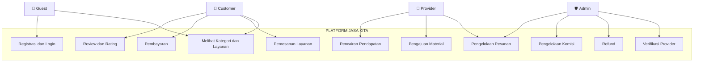
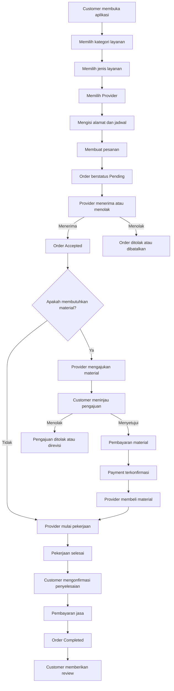
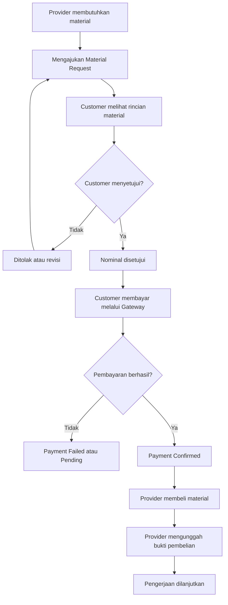
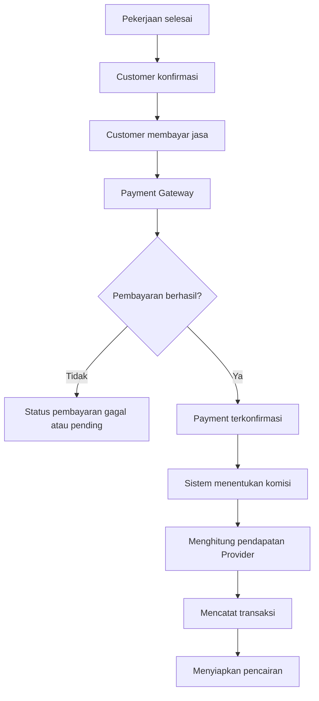
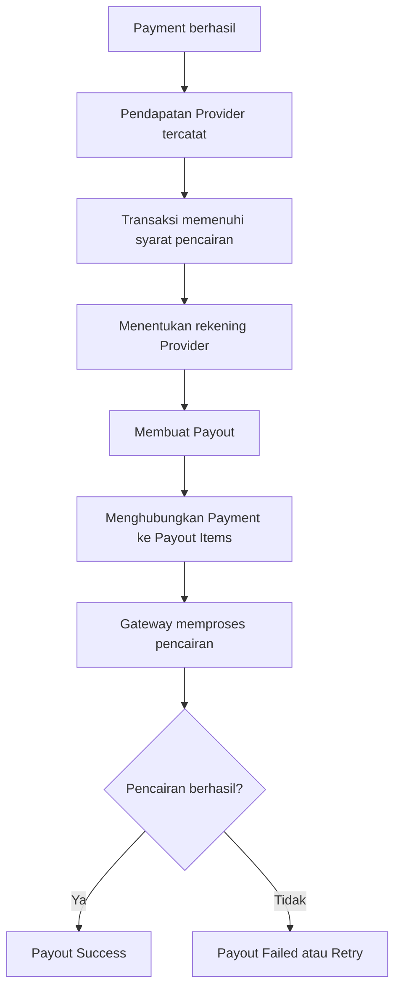
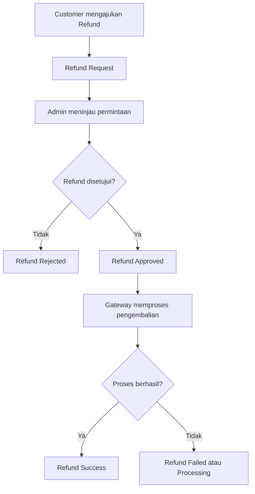
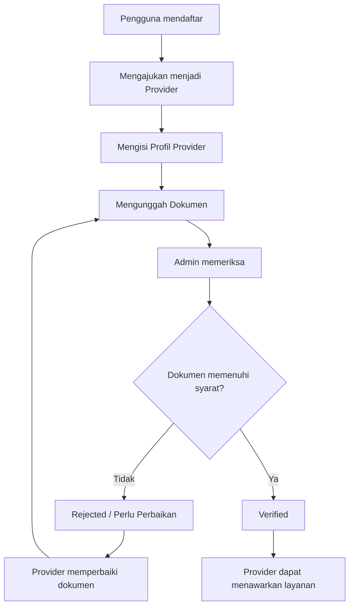

# ERD Database dan Dokumentasi Sistem Jasa Kita

## 1. Pendahuluan

Jasa Kita merupakan platform layanan jasa yang menghubungkan Customer (pelanggan) dengan Provider (penyedia jasa). Platform ini dirancang untuk memudahkan Customer dalam mencari, memilih, dan memesan layanan jasa, serta membantu Provider dalam mengelola layanan, menerima pesanan, dan memperoleh pendapatan dari pekerjaan yang dilakukan.

Sistem Jasa Kita juga menyediakan mekanisme pembayaran melalui payment gateway, pengajuan biaya material, pengelolaan komisi platform, pencairan pendapatan Provider, penilaian layanan, serta pengawasan oleh Admin.

Dokumentasi ini menjelaskan struktur database Jasa Kita, hubungan antarentitas, fungsi setiap tabel, dan alur kerja sistem secara keseluruhan.

### Tujuan Database

Database Jasa Kita dirancang untuk:

- Menyimpan data pengguna dan hak akses.
- Mengelola profil dan verifikasi Provider.
- Mengelola kategori dan layanan jasa.
- Mengelola pemesanan dan status pesanan.
- Mengelola pengajuan serta pembayaran material.
- Mencatat pembayaran jasa melalui payment gateway.
- Mengelola komisi platform.
- Mengelola refund atau pengembalian dana.
- Mengelola pencairan pendapatan Provider.
- Menyimpan penilaian Customer terhadap layanan.

---

## 2. Pengguna dan Aktor Sistem

Jasa Kita memiliki empat aktor utama dalam sistem.

| Aktor | Penjelasan |
|---|---|
| Guest | Pengunjung yang belum memiliki akun. Dapat melihat layanan yang tersedia dan melakukan registrasi. |
| Customer | Pengguna yang mencari layanan, melakukan pemesanan, pembayaran, serta memberikan penilaian. |
| Provider | Penyedia jasa yang mendaftarkan layanan, menerima pesanan, mengajukan material, dan mengerjakan pesanan. |
| Admin | Pengelola sistem yang melakukan verifikasi Provider, pengawasan transaksi, penanganan refund, dan pengelolaan platform. |

Satu pengguna dapat memiliki lebih dari satu role. Contohnya, seseorang dapat menjadi Customer sekaligus Provider dengan menggunakan satu akun.

---

## 3. Diagram Aktor dan Interaksi Sistem

Diagram berikut menggambarkan hubungan antara aktor dengan fungsi utama sistem Jasa Kita.

### Penjelasan Interaksi

- Guest dapat melihat layanan tanpa harus login.
- Guest harus melakukan registrasi untuk menjadi pengguna yang dapat melakukan pemesanan.
- Customer dapat membuat pesanan, melakukan pembayaran, dan memberikan review.
- Provider dapat mengelola layanan, menerima pesanan, mengajukan material, dan menyelesaikan pekerjaan.
- Admin bertanggung jawab terhadap verifikasi Provider, pengawasan pesanan, refund, dan pengelolaan sistem.

---

## 4. Entity Relationship Diagram (ERD)

ERD berikut menggambarkan struktur database Jasa Kita beserta hubungan antarentitas. Diagram mencakup pengelolaan akun, Provider, layanan, pesanan, pembayaran, refund, komisi, pencairan pendapatan, dan review.

```mermaid
erDiagram

    USERS {
        bigint id PK
        varchar name
        varchar email UK
        varchar phone UK
        varchar password_hash
        varchar status
        datetime email_verified_at
        datetime created_at
        datetime updated_at
        datetime deleted_at
    }

    ROLES {
        bigint id PK
        varchar role_name UK
        datetime created_at
    }

    USER_ROLES {
        bigint id PK
        bigint user_id FK
        bigint role_id FK
        datetime created_at
    }

    PROVIDER_PROFILES {
        bigint id PK
        bigint user_id FK
        varchar provider_type
        varchar business_name
        text description
        text address
        varchar verification_status
        datetime verified_at
        bigint verified_by FK
        text rejection_reason
        datetime created_at
        datetime updated_at
    }

    PROVIDER_DOCUMENTS {
        bigint id PK
        bigint provider_profile_id FK
        varchar document_type
        varchar document_path
        varchar verification_status
        text notes
        bigint reviewed_by FK
        datetime uploaded_at
        datetime reviewed_at
    }

    SERVICE_CATEGORIES {
        bigint id PK
        varchar category_name UK
        boolean is_active
        datetime created_at
        datetime updated_at
    }

    SERVICES {
        bigint id PK
        bigint category_id FK
        varchar service_name
        text description
        varchar price_unit
        boolean is_active
        datetime created_at
        datetime updated_at
    }

    PROVIDER_SERVICES {
        bigint id PK
        bigint provider_profile_id FK
        bigint service_id FK
        decimal base_price
        boolean is_available
        datetime created_at
        datetime updated_at
    }

    ORDERS {
        bigint id PK
        varchar order_code UK
        bigint customer_id FK
        bigint provider_service_id FK
        varchar service_name_snapshot
        decimal service_price_snapshot
        decimal commission_rate_snapshot
        text order_address
        text description
        datetime scheduled_at
        varchar status
        datetime completed_at
        datetime cancelled_at
        bigint cancelled_by FK
        text cancel_reason
        datetime created_at
        datetime updated_at
    }

    ORDER_STATUS_HISTORIES {
        bigint id PK
        bigint order_id FK
        varchar from_status
        varchar to_status
        bigint changed_by FK
        text note
        datetime created_at
    }

    MATERIAL_REQUESTS {
        bigint id PK
        bigint order_id FK
        text description
        decimal requested_amount
        decimal approved_amount
        varchar status
        bigint responded_by FK
        datetime approved_at
        varchar purchase_receipt
        datetime created_at
        datetime updated_at
    }

    PAYMENTS {
        bigint id PK
        bigint order_id FK
        bigint material_request_id FK
        varchar payment_type
        decimal amount
        decimal platform_fee
        decimal provider_net
        varchar gateway_reference UK
        varchar status
        datetime paid_at
        datetime created_at
        datetime updated_at
    }

    REFUNDS {
        bigint id PK
        bigint payment_id FK
        bigint requested_by FK
        bigint reviewed_by FK
        decimal refund_amount
        text reason
        varchar status
        varchar gateway_reference UK
        datetime created_at
        datetime reviewed_at
        datetime refunded_at
        datetime updated_at
    }

    PROVIDER_BANK_ACCOUNTS {
        bigint id PK
        bigint provider_profile_id FK
        varchar bank_name
        varchar account_number
        varchar account_holder
        boolean is_primary
        datetime created_at
        datetime updated_at
    }

    PAYOUTS {
        bigint id PK
        bigint provider_profile_id FK
        bigint bank_account_id FK
        varchar bank_name_snapshot
        varchar account_number_snapshot
        varchar account_holder_snapshot
        decimal amount
        varchar status
        varchar gateway_reference UK
        datetime processed_at
        datetime created_at
        datetime updated_at
    }

    PAYOUT_ITEMS {
        bigint id PK
        bigint payout_id FK
        bigint payment_id FK
        datetime created_at
    }

    REVIEWS {
        bigint id PK
        bigint order_id FK
        bigint customer_id FK
        bigint provider_profile_id FK
        int rating "Nilai 1 sampai 5"
        text comment
        datetime created_at
        datetime updated_at
    }

    COMMISSION_SETTINGS {
        int id PK
        decimal commission_rate
        datetime effective_from
        datetime effective_until
        datetime created_at
        datetime updated_at
    }

    USERS ||--o{ USER_ROLES : has
    ROLES ||--o{ USER_ROLES : assigned

    USERS ||--o| PROVIDER_PROFILES : owns
    PROVIDER_PROFILES ||--o{ PROVIDER_DOCUMENTS : has
    USERS ||--o{ PROVIDER_PROFILES : verifies

    SERVICE_CATEGORIES ||--o{ SERVICES : contains
    PROVIDER_PROFILES ||--o{ PROVIDER_SERVICES : offers
    SERVICES ||--o{ PROVIDER_SERVICES : offered_by

    USERS ||--o{ ORDERS : creates
    PROVIDER_SERVICES ||--o{ ORDERS : booked_for

    ORDERS ||--o{ ORDER_STATUS_HISTORIES : has
    USERS ||--o{ ORDER_STATUS_HISTORIES : changes

    ORDERS ||--o{ MATERIAL_REQUESTS : has

    ORDERS ||--o{ PAYMENTS : receives
    MATERIAL_REQUESTS ||--o{ PAYMENTS : associated_with

    PAYMENTS ||--o{ REFUNDS : may_have
    USERS ||--o{ REFUNDS : requests
    USERS ||--o{ REFUNDS : reviews

    PROVIDER_PROFILES ||--o{ PROVIDER_BANK_ACCOUNTS : owns
    PROVIDER_PROFILES ||--o{ PAYOUTS : receives
    PROVIDER_BANK_ACCOUNTS ||--o{ PAYOUTS : destination

    PAYOUTS ||--o{ PAYOUT_ITEMS : contains
    PAYMENTS ||--o| PAYOUT_ITEMS : included_in

    ORDERS ||--o| REVIEWS : reviewed
    USERS ||--o{ REVIEWS : writes
    PROVIDER_PROFILES ||--o{ REVIEWS : receives
```

### Catatan Diagram

- `PK` (Primary Key) merupakan identitas unik setiap data.
- `FK` (Foreign Key) merupakan kolom yang menghubungkan data dengan tabel lain.
- `UK` (Unique Key) merupakan kolom yang nilainya tidak boleh sama dengan data lainnya.
- Relasi `1:N` menunjukkan satu data dapat memiliki banyak data yang terhubung.
- Relasi `1:1` menunjukkan satu data memiliki maksimal satu data yang terhubung.
- Relasi `1:0..1` menunjukkan data boleh memiliki atau tidak memiliki pasangan data.

**Catatan penting:**

- `commission_rate_snapshot` menyimpan persentase komisi yang digunakan ketika pesanan dibuat.
- `commission_settings` menyimpan pengaturan persentase komisi berdasarkan periode berlakunya.
- Nilai komisi pada pesanan tidak berubah meskipun pengaturan komisi diperbarui.
- Kolom snapshot rekening pada `payouts` menyimpan informasi rekening yang digunakan ketika pencairan dibuat.
- `platform_fee` dan `provider_net` pada `payments` menyimpan rincian komisi platform dan pendapatan bersih Provider untuk setiap transaksi pembayaran.

Diagram ini merupakan representasi hubungan database. Detail constraint dan aturan validasi tetap mengikuti implementasi DBML serta aturan aplikasi.

## 5. Penjelasan Struktur Database

Database Jasa Kita terdiri dari 18 tabel yang dikelompokkan berdasarkan fungsi sistem.

### A. Account & Role Management

#### 1. `users`

Tabel `users` merupakan tabel utama untuk menyimpan data akun seluruh pengguna Jasa Kita.

Data yang disimpan meliputi:

- ID pengguna.
- Nama lengkap.
- Email.
- Nomor telepon.
- Password yang sudah di-hash.
- Status akun.
- Waktu verifikasi email.
- Waktu pembuatan dan perubahan akun.

Tabel ini digunakan oleh Customer, Provider, dan Admin.

**Fungsi:** Mengelola identitas, autentikasi, dan informasi dasar pengguna.

#### 2. `roles`

Tabel `roles` menyimpan daftar peran yang tersedia di dalam sistem.

Contoh role:

- Customer
- Provider
- Admin

Role digunakan untuk membatasi hak akses dan menentukan fitur yang dapat digunakan oleh pengguna.

**Fungsi:** Menentukan peran pengguna dalam sistem.

#### 3. `user_roles`

Tabel `user_roles` menghubungkan pengguna dengan role yang dimiliki.

Contohnya, seorang pengguna memiliki satu akun dengan email tertentu, tetapi dapat memiliki role Customer dan Provider sekaligus.

Hubungan ini memungkinkan satu pengguna mempunyai beberapa peran tanpa perlu membuat akun baru.

**Fungsi:** Mengelola hubungan antara akun pengguna dan hak akses.

---

### B. Provider Management

#### 4. `provider_profiles`

Tabel `provider_profiles` menyimpan informasi profil penyedia jasa.

Data meliputi:

- Jenis Provider (individu atau bisnis).
- Nama usaha.
- Deskripsi usaha atau keahlian.
- Alamat.
- Status verifikasi.
- Waktu verifikasi.
- Admin yang melakukan verifikasi.
- Alasan penolakan jika tidak lolos.

Provider tidak langsung dapat menerima pesanan sebelum memenuhi ketentuan verifikasi yang ditetapkan oleh platform.

**Fungsi:** Menyimpan profil Provider dan status kelayakan Provider untuk menggunakan platform.

#### 5. `provider_documents`

Tabel `provider_documents` menyimpan dokumen pendukung proses verifikasi Provider.

Contoh dokumen:

- KTP.
- Foto papan nama usaha.
- Dokumen legalitas usaha jika relevan.
- Sertifikat keahlian jika tersedia.
- Foto portofolio atau bukti pekerjaan.

Dokumen disimpan sebagai file, sedangkan database menyimpan lokasi atau path file tersebut.

Setiap dokumen dapat memiliki status verifikasi dan catatan dari Admin.

**Fungsi:** Mendukung proses verifikasi identitas, usaha, dan kemampuan Provider.

#### 6. `provider_bank_accounts`

Tabel `provider_bank_accounts` menyimpan rekening bank milik Provider yang digunakan sebagai tujuan pencairan pendapatan.

Data meliputi:

- Nama bank.
- Nomor rekening.
- Nama pemilik rekening.
- Status rekening utama.

Satu Provider dapat memiliki lebih dari satu rekening, tetapi sistem dapat menentukan satu rekening utama sebagai tujuan pencairan.

**Fungsi:** Menyimpan informasi rekening tujuan payout.

---

### C. Service Management

#### 7. `service_categories`

Tabel `service_categories` menyimpan kategori layanan jasa.

Contoh:

- Perbaikan Elektronik.
- AC.
- Instalasi Listrik.
- Plumbing.
- Kebersihan.
- Renovasi.

Kategori digunakan untuk memudahkan Customer mencari layanan berdasarkan kebutuhan.

**Fungsi:** Mengelompokkan layanan agar pencarian lebih terstruktur.

#### 8. `services`

Tabel `services` menyimpan daftar jenis layanan yang disediakan oleh platform.

Contoh:

- Servis AC.
- Pemasangan AC.
- Perbaikan Mesin Cuci.
- Instalasi Lampu.
- Perbaikan Pipa Air.

Setiap layanan terhubung dengan kategori tertentu.

**Fungsi:** Menjadi katalog layanan yang tersedia pada platform.

#### 9. `provider_services`

Tabel `provider_services` menghubungkan Provider dengan layanan yang dapat dikerjakan.

Contohnya:

Provider A menawarkan:

- Servis AC.
- Instalasi AC.
- Perbaikan kulkas.

Provider B menawarkan:

- Instalasi listrik.
- Perbaikan lampu.

Tabel ini menyimpan harga dasar masing-masing Provider untuk layanan tertentu dan status ketersediaan layanan.

**Fungsi:** Mengelola layanan yang ditawarkan oleh masing-masing Provider beserta harga dan ketersediaannya.

---

### D. Order Management

#### 10. `orders`

Tabel `orders` merupakan tabel utama untuk menyimpan pesanan Customer.

Data yang disimpan meliputi:

- Kode pesanan.
- Customer yang melakukan pesanan.
- Layanan dan Provider yang dipilih.
- Snapshot nama layanan saat pemesanan.
- Snapshot harga layanan saat pemesanan.
- Snapshot persentase komisi (`commission_rate_snapshot`).
- Alamat pengerjaan.
- Deskripsi masalah atau kebutuhan.
- Jadwal pengerjaan.
- Status pesanan.
- Informasi penyelesaian atau pembatalan.

Snapshot nama dan harga layanan digunakan agar perubahan data layanan di kemudian hari tidak mengubah catatan transaksi lama.

Selain itu, `commission_rate_snapshot` digunakan untuk menyimpan persentase komisi yang berlaku ketika pesanan dibuat.

Dengan mekanisme ini, persentase komisi untuk suatu pesanan tetap sama meskipun Admin mengubah pengaturan komisi untuk pesanan baru.

**Fungsi:** Mencatat dan mengelola seluruh transaksi pemesanan jasa beserta snapshot informasi harga dan komisi.

---

#### 11. `order_status_histories`

Tabel `order_status_histories` menyimpan riwayat perubahan status pesanan.

Contoh:

| Status Awal | Status Berikutnya |
|---|---|
| Pending | Accepted |
| Accepted | In Progress |
| In Progress | Completed |

Tabel ini menyimpan status sebelumnya, status baru, pengguna yang melakukan perubahan, catatan, dan waktu perubahan.

**Fungsi:** Menyediakan histori pesanan dan membantu proses pengawasan serta penelusuran apabila terjadi masalah.

#### 12. `material_requests`

Tabel `material_requests` menyimpan permintaan biaya material dari Provider untuk suatu pesanan.

Data meliputi:

- Deskripsi material.
- Nominal yang diajukan.
- Nominal yang disetujui.
- Status permintaan.
- Customer yang merespons.
- Waktu persetujuan.
- Bukti pembelian material.

Contoh:

Provider mengajukan material sebesar Rp150.000. Customer dapat menyetujui atau menolak pengajuan tersebut.

Provider hanya diperbolehkan membeli material setelah pembayaran material terkonfirmasi, sesuai aturan sistem.

**Fungsi:** Mengelola kebutuhan material di luar biaya jasa utama.

---

### E. Payment & Refund Management

#### 13. `payments`

Tabel `payments` menyimpan catatan transaksi pembayaran Customer.

Jenis pembayaran:

- Pembayaran material.
- Pembayaran jasa.

Data meliputi:

- Order terkait.
- Material request jika pembayaran berkaitan dengan material.
- Jenis pembayaran.
- Nominal pembayaran.
- Biaya atau komisi platform (`platform_fee`).
- Pendapatan bersih Provider (`provider_net`).
- Referensi payment gateway.
- Status transaksi.
- Waktu pembayaran.

Pembayaran dilakukan melalui payment gateway yang akan digunakan oleh Jasa Kita.

Nilai `platform_fee` dan `provider_net` dihitung berdasarkan persentase komisi yang tersimpan pada pesanan.

Pembayaran material dan pembayaran jasa menggunakan persentase komisi yang sama sesuai `commission_rate_snapshot` pada tabel `orders`.

**Fungsi:** Mencatat pembayaran, komisi platform, pendapatan bersih Provider, dan status transaksi Customer.

---

#### 14. `refunds`

Tabel `refunds` menyimpan permintaan pengembalian dana.

Data meliputi:

- Transaksi yang akan direfund.
- Pengguna yang meminta refund.
- Admin yang meninjau.
- Nominal refund.
- Alasan refund.
- Status refund.
- Referensi gateway.
- Waktu proses dan penyelesaian.

Refund dapat berupa pengembalian sebagian maupun seluruh dana sesuai hasil peninjauan Admin dan mekanisme gateway.

**Fungsi:** Mengelola proses pengembalian dana dan dokumentasi penyelesaiannya.

---

### F. Provider Payout Management

#### 15. `payouts`

Tabel `payouts` mencatat proses pencairan pendapatan Provider.

Data meliputi:

- Provider penerima.
- Rekening tujuan.
- Nominal pencairan.
- Status pencairan.
- Referensi gateway.
- Waktu pencairan.

Payout dilakukan melalui mekanisme settlement atau disbursement yang didukung oleh payment gateway.

Data rekening tujuan juga disimpan sebagai snapshot (`bank_name_snapshot`, `account_number_snapshot`, dan `account_holder_snapshot`). Dengan demikian, riwayat payout tetap menunjukkan rekening yang digunakan saat pencairan dibuat, meskipun Provider mengubah data rekening utamanya di kemudian hari.

**Fungsi:** Mencatat proses pencairan pendapatan Provider beserta snapshot rekening tujuan.

#### 16. `payout_items`

Tabel `payout_items` menghubungkan pencairan dengan transaksi pembayaran yang menjadi sumber pendapatan Provider.

Contohnya, satu payout dapat mencakup beberapa transaksi pembayaran apabila mekanisme pencairan mendukung penggabungan transaksi.

Tabel ini membantu sistem melacak transaksi mana saja yang telah masuk ke proses pencairan.

**Fungsi:** Menyimpan rincian transaksi yang masuk ke dalam suatu payout.

---

### G. Review Management

#### 17. `reviews`

Tabel `reviews` menyimpan penilaian Customer terhadap Provider setelah pesanan selesai.

Data meliputi:

- Order yang dinilai.
- Customer pemberi penilaian.
- Provider yang menerima penilaian.
- Rating.
- Komentar.
- Waktu pemberian penilaian.

Rating menggunakan skala 1 sampai 5.

Nilai rating harus divalidasi pada aplikasi agar hanya menerima angka 1 sampai 5.

Satu pesanan hanya dapat memiliki satu review, dan Customer hanya dapat memberikan review terhadap pesanan yang telah selesai.

**Fungsi:** Menyediakan sistem evaluasi kualitas layanan dan reputasi Provider.

---

### H. Commission Management

#### 18. `commission_settings`

Tabel `commission_settings` menyimpan pengaturan persentase komisi platform berdasarkan periode berlakunya.

Data meliputi:

- Persentase komisi (`commission_rate`).
- Tanggal mulai berlaku (`effective_from`).
- Tanggal berakhir (`effective_until`).
- Waktu pembuatan dan perubahan data.

Contoh pengaturan komisi:

| Persentase Komisi | Periode |
|---|---|
| 3% | Tiga bulan pertama setelah peluncuran resmi |
| 5% | Mulai bulan keempat dan seterusnya |

Ketika Customer membuat pesanan, sistem mengambil persentase komisi yang berlaku dari tabel `commission_settings`.

Persentase tersebut kemudian disimpan ke dalam kolom `commission_rate_snapshot` pada tabel `orders`.

Dengan demikian, perubahan persentase komisi hanya berlaku untuk pesanan baru dan tidak mengubah perhitungan komisi pada pesanan yang sudah dibuat sebelumnya.

Periode berlaku setiap pengaturan komisi tidak boleh saling tumpang tindih.

**Fungsi:** Mengelola persentase komisi platform berdasarkan periode berlakunya.

---

---

## 6. Penjelasan Relasi Antar Tabel

### 6.1 Relasi Users dan Roles

`users` terhubung dengan `roles` melalui `user_roles`.

Hubungan ini menggunakan konsep many-to-many:

- Satu pengguna dapat memiliki banyak role.
- Satu role dapat dimiliki banyak pengguna.

Contohnya, beberapa pengguna memiliki role Customer, dan satu pengguna dapat memiliki role Customer sekaligus Provider.

### 6.2 Relasi Users dan Provider Profiles

Satu akun pengguna dapat memiliki satu profil Provider.

Profil Provider terhubung ke akun melalui `user_id`.

Dengan demikian, akun pengguna tidak perlu dibuat ulang ketika ingin menjadi Provider.

### 6.3 Relasi Provider Profiles dan Provider Documents

Satu Provider dapat memiliki banyak dokumen verifikasi.

Contohnya:

- Dokumen identitas.
- Foto usaha.
- Sertifikat.
- Portofolio.

Semua dokumen tersebut disimpan sebagai data terpisah agar proses verifikasi lebih fleksibel.

### 6.4 Relasi Categories dan Services

Satu kategori dapat memiliki banyak layanan.

Contohnya kategori Elektronik memiliki layanan servis AC, perbaikan kulkas, dan perbaikan mesin cuci.

Setiap layanan berada dalam satu kategori yang ditentukan.

### 6.5 Relasi Provider Services

`provider_services` merupakan penghubung antara Provider dan Services.

Relasi ini memungkinkan:

- Satu Provider menawarkan banyak layanan.
- Satu layanan ditawarkan oleh banyak Provider.

Harga layanan dapat berbeda antara satu Provider dengan Provider lainnya.

### 6.6 Relasi Orders

Pesanan menghubungkan Customer dengan layanan yang ditawarkan Provider.

Setiap order mencatat Customer, layanan Provider, dan informasi pesanan.

Order menjadi pusat hubungan dengan pembayaran, material, riwayat status, dan review.

### 6.7 Relasi Orders dan Material Requests

Satu pesanan dapat memiliki pengajuan material.

Pengajuan material digunakan apabila pengerjaan membutuhkan bahan atau komponen tambahan yang biayanya tidak termasuk harga jasa awal.

### 6.8 Relasi Orders dan Payments

Satu order dapat memiliki lebih dari satu pembayaran.

Contohnya:

1. Pembayaran material.
2. Pembayaran jasa.

Setiap pembayaran disimpan secara terpisah agar transaksi dapat ditelusuri.

### 6.9 Relasi Payments dan Refunds

Satu transaksi pembayaran dapat memiliki proses refund apabila diperlukan.

Refund tidak menghapus transaksi pembayaran asli. Refund disimpan sebagai catatan terpisah agar histori keuangan tetap tersedia.

### 6.10 Relasi Payments dan Payout Items

Pembayaran yang menjadi hak Provider dapat dimasukkan ke proses payout.

Payout items digunakan untuk melacak pembayaran yang sudah dimasukkan ke pencairan.

### 6.11 Relasi Orders dan Reviews

Review terhubung ke pesanan yang telah selesai.

Customer memberikan rating dan komentar terhadap Provider yang mengerjakan pesanan.

### 6.12 Relasi Commission Settings

Pengaturan komisi digunakan oleh sistem untuk menentukan persentase komisi yang berlaku berdasarkan waktu transaksi.

Relasi ini bersifat konseptual berdasarkan periode berlaku, bukan harus berupa Foreign Key langsung pada setiap pembayaran.

Untuk keperluan audit, nilai komisi yang digunakan pada transaksi perlu disimpan sebagai snapshot pada catatan transaksi keuangan.

---

## 7. Alur Pemesanan Jasa

Alur pemesanan merupakan proses utama dalam aplikasi Jasa Kita.

### Penjelasan Alur

1. Customer mencari layanan yang dibutuhkan.
2. Customer memilih Provider yang tersedia.
3. Customer mengisi alamat, jadwal, dan deskripsi pekerjaan.
4. Sistem menyimpan pesanan ke tabel `orders`.
5. Provider menerima atau menolak pesanan.
6. Jika pesanan diterima, Provider memulai proses pengerjaan.
7. Jika membutuhkan material, Provider mengajukan biaya material.
8. Customer menyetujui pengajuan dan membayar material.
9. Setelah pembayaran material terkonfirmasi, Provider dapat membeli material.
10. Provider mengerjakan pesanan.
11. Setelah pekerjaan selesai, Customer melakukan konfirmasi penyelesaian.
12. Customer melakukan pembayaran jasa.
13. Order menjadi Completed.
14. Customer dapat memberikan review.

---

## 8. Alur Pembayaran Material

Pembayaran material merupakan pembayaran terpisah dari biaya jasa.

### Ketentuan Pembayaran Material

- Provider mengajukan rincian material terlebih dahulu.
- Customer harus menyetujui nominal material.
- Pembayaran dilakukan melalui payment gateway.
- Provider tidak boleh membeli material sebelum pembayaran terkonfirmasi.
- Provider mengunggah bukti pembelian setelah material dibeli.
- Jika harga material berubah, Provider harus mengajukan revisi.
- Revisi biaya tidak boleh dibebankan secara otomatis tanpa persetujuan Customer.

---

## 9. Alur Pembayaran Jasa dan Komisi

Pembayaran jasa dilakukan setelah pengerjaan selesai dan Customer mengonfirmasi pekerjaan.

Contoh:

| Komponen | Nominal |
|---|---:|
| Biaya jasa | Rp300.000 |
| Material | Rp150.000 |
| Total pembayaran Customer | Rp450.000 |

Dengan komisi platform 5%:

| Komponen | Nominal |
|---|---:|
| Total pembayaran | Rp450.000 |
| Komisi platform 5% | Rp22.500 |
| Pendapatan Provider | Rp427.500 |

Contoh di atas menggunakan kebijakan komisi yang dihitung dari total pembayaran Customer, termasuk material, sesuai konsep bisnis yang telah direncanakan.

### Perhitungan Komisi

Rumus dasar:

**Komisi Platform = Total pembayaran × Persentase komisi**

**Pendapatan Provider = Total pembayaran − Komisi Platform**

### Mekanisme Penentuan Persentase Komisi

Persentase komisi platform ditentukan berdasarkan pengaturan yang tersimpan pada tabel `commission_settings`.

Ketentuan persentase komisi Jasa Kita:

| Periode | Persentase Komisi |
|---|---:|
| Tiga bulan pertama setelah peluncuran resmi | 3% |
| Mulai bulan keempat dan seterusnya | 5% |

Ketika Customer membuat pesanan, sistem mengambil persentase komisi yang sedang berlaku berdasarkan tanggal pembuatan pesanan. Persentase tersebut kemudian disimpan ke dalam kolom `commission_rate_snapshot` pada tabel `orders`.

Dengan mekanisme ini, persentase komisi untuk setiap pesanan akan tetap terkunci sejak pesanan dibuat. Apabila Admin mengubah persentase komisi, perubahan tersebut hanya berlaku untuk pesanan baru dan tidak memengaruhi pesanan yang sudah ada.

Pembayaran material dan pembayaran jasa dalam satu pesanan menggunakan persentase komisi yang sama, yaitu berdasarkan nilai `commission_rate_snapshot`.

**Contoh perhitungan dengan komisi 5%:**

| Jenis Pembayaran | Nominal | Komisi 5% | Pendapatan Provider |
|---|---:|---:|---:|
| Material | Rp150.000 | Rp7.500 | Rp142.500 |
| Jasa | Rp300.000 | Rp15.000 | Rp285.000 |
| **Total** | **Rp450.000** | **Rp22.500** | **Rp427.500** |

Nilai komisi (`platform_fee`) dan pendapatan bersih Provider (`provider_net`) disimpan pada masing-masing transaksi di tabel `payments`.

**Catatan:** Perhitungan komisi material dan jasa harus menggunakan persentase yang sama dari snapshot pesanan dan tidak boleh menyebabkan perhitungan komisi ganda. Nilai komisi dan pendapatan bersih Provider harus direkonsiliasi dengan kebijakan settlement gateway.

---

## 10. Alur Pencairan Pendapatan Provider

Pencairan pendapatan Provider dilakukan melalui mekanisme gateway yang mendukung settlement atau disbursement.

### Penjelasan

1. Pembayaran Customer berhasil.
2. Sistem menghitung hak pendapatan Provider.
3. Sistem menentukan transaksi yang dapat dicairkan.
4. Sistem menggunakan rekening Provider yang terdaftar.
5. Sistem membuat catatan payout.
6. Pembayaran yang dicairkan dicatat pada payout items.
7. Gateway memproses pencairan.
8. Status payout diperbarui berdasarkan konfirmasi gateway.

Jasa Kita tidak menggunakan wallet internal dalam rancangan MVP. Pencairan mengikuti mekanisme yang disediakan payment gateway.

---

## 11. Alur Refund

Refund dilakukan apabila terdapat alasan yang memenuhi kebijakan pengembalian dana.

### Ketentuan Refund

- Refund dapat berupa pengembalian dana sebagian atau seluruh dana.
- Refund harus ditinjau oleh Admin.
- Refund tidak menghapus pembayaran asli.
- Pengembalian dana mengikuti kemampuan dan mekanisme payment gateway.
- Refund hanya dianggap berhasil setelah terdapat konfirmasi proses pengembalian.
- Jika material belum dibeli, pengembalian biaya material dapat dilakukan sesuai kebijakan.
- Jika material sudah dibeli, Admin perlu mempertimbangkan bukti pembelian, kondisi material, kemungkinan pengembalian, dan tanggung jawab pihak terkait.
- Status refund dicatat untuk memudahkan pelacakan.

---

## 12. Alur Verifikasi Provider

### Penjelasan

Provider perlu melewati proses verifikasi sebelum dapat menerima pesanan sesuai kebijakan platform.

Verifikasi dilakukan untuk meningkatkan kepercayaan dan mengurangi risiko pengguna.

Dokumen yang dibutuhkan dapat berbeda antara Provider individu dan bisnis.

---

## 13. Aturan Bisnis Utama

Berikut aturan bisnis yang menjadi dasar implementasi sistem Jasa Kita.

### Akun dan Hak Akses

- Guest dapat melihat layanan tanpa login.
- Customer harus memiliki akun untuk melakukan pesanan.
- Satu pengguna dapat memiliki lebih dari satu role.
- Admin merupakan role khusus yang diberikan oleh pengelola sistem.

### Provider

- Provider wajib mengisi profil.
- Provider wajib mengunggah dokumen yang dipersyaratkan.
- Provider harus melewati verifikasi sebelum menerima pesanan sesuai kebijakan sistem.
- Provider dapat menawarkan lebih dari satu layanan.
- Provider dapat menentukan harga layanan yang ditawarkan.

### Order

- Setiap pesanan memiliki kode unik.
- Harga dan nama layanan disimpan sebagai snapshot saat pemesanan.
- Pesanan memiliki status yang dapat berubah.
- Perubahan status dicatat dalam histori.
- Pesanan yang selesai dapat menjadi dasar review.

### Material

- Material diajukan oleh Provider.
- Customer harus menyetujui pengajuan.
- Provider menunggu konfirmasi pembayaran sebelum membeli material.
- Revisi biaya membutuhkan persetujuan Customer.
- Bukti pembelian material perlu disimpan.

### Payment

- Pembayaran menggunakan payment gateway.
- Pembayaran material dan jasa dicatat secara terpisah.
- Status transaksi harus berdasarkan konfirmasi gateway.
- Setiap transaksi memiliki referensi unik.

### Komisi

- Komisi ditentukan berdasarkan pengaturan periode.
- Komisi dicatat sebagai bagian transaksi.
- Perubahan persentase tidak boleh mengubah komisi transaksi lama.
- Perhitungan komisi harus konsisten dengan kebijakan bisnis.

### Refund

- Refund dapat diajukan jika memenuhi kebijakan.
- Admin melakukan peninjauan.
- Refund dapat sebagian atau penuh.
- Proses pengembalian mengikuti gateway.

### Payout

- Pendapatan Provider dicairkan melalui mekanisme gateway.
- Rekening Provider harus tersedia dan valid.
- Transaksi yang masuk payout harus dapat ditelusuri.
- Status payout mengikuti hasil gateway.

### Review

- Review hanya dapat dilakukan setelah pesanan selesai.
- Satu pesanan hanya memiliki satu review.
- Rating berada pada rentang 1–5.

---

## 14. Status yang Digunakan dalam Sistem

Status berikut merupakan rancangan awal dan dapat disesuaikan saat implementasi.

### Order Status

| Status | Penjelasan |
|---|---|
| Pending | Pesanan menunggu respons Provider |
| Accepted | Pesanan diterima Provider |
| Rejected | Pesanan ditolak Provider |
| In Progress | Pengerjaan sedang berlangsung |
| Completed | Pesanan selesai |
| Cancelled | Pesanan dibatalkan |

### Material Request Status

| Status | Penjelasan |
|---|---|
| Pending | Menunggu persetujuan Customer |
| Approved | Disetujui Customer |
| Rejected | Ditolak Customer |
| Paid | Pembayaran terkonfirmasi |
| Purchased | Material telah dibeli |

### Payment Status

| Status | Penjelasan |
|---|---|
| Pending | Menunggu pembayaran atau konfirmasi |
| Success | Pembayaran berhasil |
| Failed | Pembayaran gagal |
| Expired | Batas pembayaran berakhir |
| Cancelled | Pembayaran dibatalkan |

### Refund Status

| Status | Penjelasan |
|---|---|
| Pending | Menunggu tinjauan Admin |
| Approved | Refund disetujui |
| Rejected | Refund ditolak |
| Processing | Refund sedang diproses |
| Success | Refund berhasil |
| Failed | Refund gagal |

### Payout Status

| Status | Penjelasan |
|---|---|
| Pending | Menunggu proses |
| Processing | Sedang diproses |
| Success | Pencairan berhasil |
| Failed | Pencairan gagal |

### Provider Verification Status

| Status | Penjelasan |
|---|---|
| Pending | Menunggu pemeriksaan |
| Verified | Lolos verifikasi |
| Rejected | Ditolak |
| Revision Required | Memerlukan perbaikan dokumen |

---

## 15. Catatan Implementasi Database

Rancangan ERD ini merupakan dasar pengembangan database. Beberapa detail teknis perlu dipastikan ketika pembuatan database dilakukan.

### Constraint

- Email harus unik.
- Nomor telepon harus unik sesuai kebijakan.
- Setiap order memiliki kode unik.
- Gateway reference harus unik jika tersedia.
- Kombinasi user-role tidak boleh duplikat.
- Kombinasi Provider-Service tidak boleh duplikat.
- Satu order hanya memiliki satu review.
- Nilai `reviews.rating` harus berada pada rentang 1–5 (misalnya `CHECK (rating BETWEEN 1 AND 5)`) dan tetap divalidasi pada aplikasi.
- `refunds.gateway_reference` harus unik untuk mencegah referensi gateway refund duplikat (perhatikan nilai NULL jika gateway reference belum tersedia).
- Snapshot rekening pada payout diisi dari rekening yang digunakan ketika payout dibuat.
- Satu payment tidak boleh masuk lebih dari satu payout item jika menggunakan model pencairan tersebut.

### Keamanan

- Password disimpan menggunakan hashing.
- Dokumen Provider tidak boleh dapat diakses sembarang pengguna.
- Nomor rekening perlu dilindungi.
- Hak akses Admin harus dibatasi.
- Validasi pembayaran harus dilakukan berdasarkan konfirmasi gateway.

### Konsistensi Keuangan

- Nominal transaksi tidak boleh berubah setelah transaksi berhasil.
- Komisi transaksi harus tersimpan sebagai snapshot.
- Refund tidak boleh melebihi nominal yang dapat dikembalikan.
- Pendapatan Provider harus dapat direkonsiliasi.
- Payout tidak boleh mencairkan transaksi yang sama berulang kali.

### Pengembangan Bertahap

Fitur tambahan yang dapat dikembangkan setelah MVP:

- Notifikasi.
- Chat Customer dan Provider.
- Riwayat revisi material.
- Portofolio Provider yang lebih lengkap.
- Sistem pelaporan.
- Moderasi review.
- Dashboard statistik.
- Pengelolaan transaksi keuangan yang lebih detail.

---

## 16. Kesimpulan

Database Jasa Kita dirancang menggunakan pendekatan relasional dengan 18 tabel yang saling terhubung berdasarkan fungsi masing-masing.

Struktur database dibagi menjadi beberapa bagian utama:

1. Account & Role Management.
2. Provider Management.
3. Service Management.
4. Order Management.
5. Payment & Refund Management.
6. Provider Payout Management.
7. Review Management.
8. Commission Management.

Dengan struktur tersebut, sistem diharapkan mampu mendukung proses pemesanan jasa, verifikasi Provider, pembayaran material dan jasa, pengelolaan komisi, pencairan pendapatan, refund, dan penilaian layanan.

ERD ini menjadi acuan awal bagi tim dalam memahami struktur data serta hubungan antarbagian sistem sebelum database diimplementasikan ke dalam aplikasi Jasa Kita.
