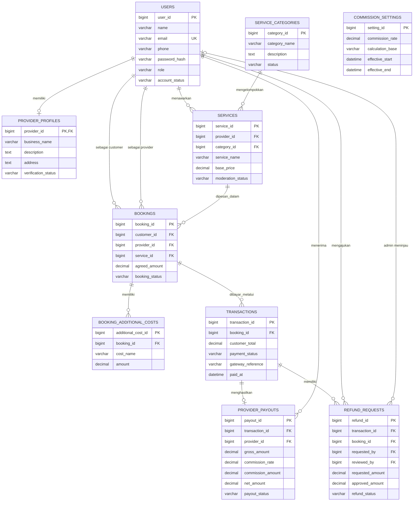

# Entity Relationship Diagram (ERD) — Jasa Kita

> **Status:** Draft konseptual berdasarkan keputusan bisnis yang telah disepakati. Kardinalitas dan atribut perlu divalidasi sebelum SQL dibuat.

## 1. Diagram ERD

## 2. Penjelasan relasi

1. Satu akun Provider memiliki satu profil Provider.
2. Satu Provider dapat menawarkan banyak layanan.
3. Satu kategori dapat digunakan oleh banyak layanan.
4. Satu Customer dapat membuat banyak pesanan; satu Provider dapat menerima banyak pesanan.
5. Satu layanan dapat muncul pada banyak pesanan.
6. Satu pesanan dapat memiliki beberapa rincian biaya tambahan, termasuk biaya material.
7. Satu pesanan dapat memiliki beberapa percobaan transaksi pembayaran.
8. Satu transaksi berhasil menghasilkan paling banyak satu catatan payout pada rancangan awal. Payout dicatat per transaksi.
9. Satu transaksi dapat memiliki beberapa permintaan atau percobaan refund, misalnya jika proses refund gagal lalu diajukan ulang. Kebijakan ini perlu divalidasi.
10. Pengaturan komisi disimpan berdasarkan periode efektif. Tarif yang benar-benar diterapkan harus disalin sebagai snapshot ke catatan payout agar perubahan tarif tidak mengubah transaksi lama.

## 3. Aturan perhitungan

- Total pembayaran Customer = harga layanan yang disepakati + seluruh biaya tambahan yang disetujui.
- Komisi = total pembayaran Customer × tarif komisi yang berlaku.
- Pendapatan bersih Provider = total pembayaran Customer − komisi.
- Biaya material termasuk dalam biaya tambahan dan ikut menjadi dasar perhitungan komisi.
- Tarif promo 3% berlaku selama tiga bulan pertama sejak peluncuran resmi; setelah itu tarif normal 5%.
- Payout diproses per transaksi berhasil, jika didukung payment gateway yang dipilih.
- Refund harus melalui pemeriksaan Admin. Status refund menjadi berhasil hanya setelah dikonfirmasi oleh penyedia pembayaran.

## 4. Catatan desain sebelum implementasi

- `commission_settings` adalah tabel referensi kebijakan; `provider_payouts` menyimpan snapshot tarif dan nominal komisi yang benar-benar diterapkan.
- Untuk menghindari duplikasi, implementasi perlu memastikan hanya satu pembayaran final berhasil untuk satu pesanan dan paling banyak satu payout final untuk transaksi tersebut.
- Detail rekening atau tujuan pencairan Provider belum dimodelkan karena mekanisme dan payment gateway belum dipilih.
- Diagram ini belum mencakup seluruh tabel pendukung seperti dokumen verifikasi, chat, notifikasi, rating, audit log, dan jadwal layanan. Tabel tersebut dapat ditambahkan setelah kebutuhan fitur dipetakan.
