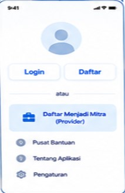
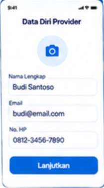
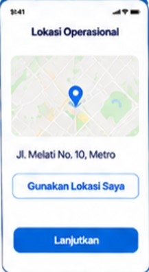
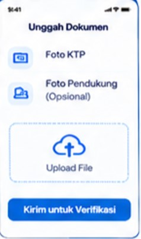
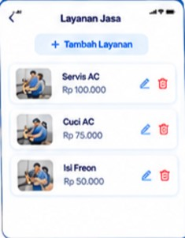
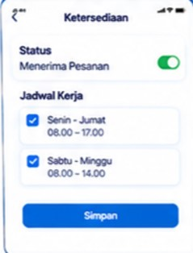
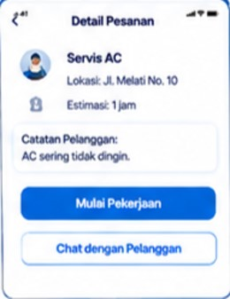
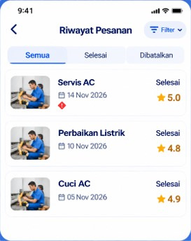
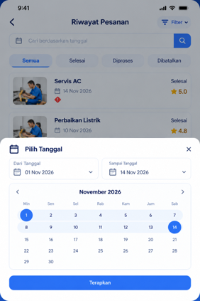

## Provider (Mitra / Penyedia Jasa)

**14 fitur**

Provider merupakan pengguna yang berperan sebagai penyedia atau mitra layanan jasa di dalam 
aplikasi Jasa Kita. Provider dapat menawarkan layanan, mengelola profil, menerima permintaan 
pemesanan, dan memperbarui perkembangan pekerjaan.

### 1. Halaman Fitur Profil

**Deskripsi:** Fitur Provider membuka dan mengakses Profil data 
diri Provider

**Tujuan:** Mengakses menu akun untuk masuk atau daftar

### 2. Halaman mengisi data profil sebagai Provider

**Deskripsi:** Fitur ini memungkinkan Provider mengisi Data diri 
mereka

**Tujuan:** Membantu Provider mmengisi data diri sebagai 
penyedia jasa, seperti data Nama, Email, No Hp

---

### 3. Fitur Mengisi dan Mengelola Informasi Profil

**Deskripsi:** Fitur ini memungkinkan Provider mengelola dan 
memperbarui informasi profil, seperti identitas serta 
informasi lain yang berkaitan dengan dirinya sebagai 
penyedia jasa.

**Tujuan:** Membantu Customer mengetahui identitas dan 
informasi penyedia jasa sebelum melakukan pemesanan.

### 4. Fitur Menambahkan Informasi Lokasi Jasa

**Deskripsi:** Fitur ini memungkinkan Provider menambahkan 
informasi mengenai lokasi jasa yang ingin ditawarkan kepada 
Customer sesuai kemampuan dan bidang pekerjaannya.

**Tujuan:** Memudahkan Provider memberitahu lokasi layanan 
agar dapat ditemukan oleh calon pelanggan.

---

### 5. Verifikasi Data Diri Provider

**Deskripsi:** Fitur ini memungkinkan Provider untuk 
mengunggah data diri mereka yang nantinya akan di validasi 
oleh admin

**Tujuan:** Mewajibkan Provider untuk mengunggah 
dokumen seperti KTP, Surat Izin Usaha dan dokumen 
lainnya

### 6. Menunggu Verifikasi sebagai Provider

**Deskripsi:** Fitur ini ditujukan untuk Provider bahwa data 
sedang di verifikasi oleh admin

**Tujuan:** Untuk memberi tahu Provider bahwa data sedang di 
cocokan oleh Admin, apakah foto ktp, Surat Usaha dan wajah 
cocok dengan yang ada di lokasi/ benar adanya usaha tersebut

---

**Jika Sudah di Verifikasi data dan di setujui,**
**Masuk ke tahap Mengatur ketersedian layanan, lokasi, dan lainnya**

### 7. Fitur Mengatur dan menambah Ketersediaan Layanan

**Deskripsi:** Fitur ini memungkinkan Provider mengatur 
ketersediaan layanan untuk menentukan jasa appa saya yang 
bisa diberikan.

**Tujuan:** Memberikan kendali kepada Provider dalam 
mengatur ketersediaan layanan sesuai keahlian masing 
masing

### 8. Halaman fitur ketersediaan Jam Operasional

**Deskripsi:** Fitur ini bertujuan untuk memberi tahu 
Pelangan jam berapa saja pihak provider berkerja

**Tujuan:** Memudahkan Pelanggan mengetahui Jam 
operasional pihak Penyedia Jasa

---

### 9. Fitur Melihat Daftar Permintaan Pesanan

**Deskripsi:** Fitur ini memungkinkan Provider melihat 
daftar permintaan pemesanan yang dikirimkan oleh 
Customer melalui aplikasi Jasa Kita.

**Tujuan:** Memudahkan Provider mengetahui 
permintaan layanan yang masuk dan menentukan 
pesanan yang akan ditangani.

#### 10. Fitur Menerima atau Menolak Pesanan

**Deskripsi:** Fitur ini memungkinkan Provider 
menentukan apakah permintaan pemesanan dari 
Customer akan diterima atau ditolak berdasarkan 
kemampuan dan ketersediaan layanan.

**Tujuan:** Memberikan kewenangan kepada Provider 
untuk memilih pekerjaan yang sanggup dikerjakan.

---

### 11. Fitur Melihat Detail Pemesanan

**Deskripsi:** Fitur ini memungkinkan Provider melihat 
informasi pesanan, termasuk detail kebutuhan pekerjaan 
dan lokasi yang telah dimasukkan oleh Customer.

**Tujuan:** Membantu Provider memahami kebutuhan 
pelanggan sebelum melaksanakan pekerjaan.

### 12.Fitur Mengirim Pesan kepada Pelanggan melalui Chat

**Deskripsi :** Fitur ini memungkinkan Provider 
berkomunikasi secara langsung dengan Customer 
untuk membahas kebutuhan, detail pekerjaan, dan 
informasi lain yang berkaitan dengan pesanan.

**Tujuan:** Mempermudah komunikasi agar pekerjaan 
dapat dipahami dan dilaksanakan sesuai kebutuhan 
pelanggan.

---

### 13.Fitur Melihat Riwayat Pesanan

**Deskripsi:** Fitur ini memungkinkan Provider melihat 
daftar pekerjaan atau pesanan yang pernah diterima 
dan ditangani sebelumnya.

**Tujuan:** Memudahkan Provider memeriksa kembali 
riwayat pekerjaan yang telah dilakukan melalui 
aplikasi.

### 14.Fitur Melihat Riwayat Pesanan berdasarkan tanggal

**Deskripsi:** Fitur ini memungkinkan Provider melihat 
daftar pekerjaan atau pesanan yang pernah diterima 
dan ditangani sebelumnya berdasarkan tanggal

**Tujuan:** Memudahkan Provider memeriksa kembali 
riwayat pekerjaan yang telah dilakukan melalui 
aplikasi.
