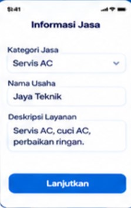
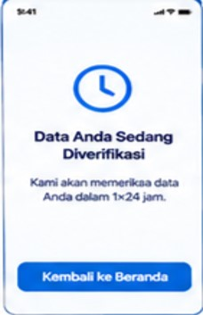
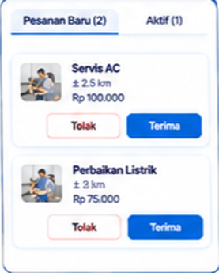

## Provider (Mitra / Penyedia Jasa)

**14 fitur**

Provider merupakan pengguna yang berperan sebagai penyedia atau mitra layanan jasa di dalam 
aplikasi Jasa Kita. Provider dapat menawarkan layanan, mengelola profil, menerima permintaan 
pemesanan, dan memperbarui perkembangan pekerjaan.

### 1. Halaman Fitur Profil

**Deskripsi:** Halaman ini memungkinkan Provider mengakses menu profil akun untuk melihat informasi akun serta memilih tindakan seperti masuk atau mendaftar sebagai penyedia jasa.

**Tujuan:** Memudahkan pengguna mengakses akun dan memulai proses pendaftaran sebagai Provider di aplikasi Jasa Kita.

### 2. Halaman mengisi data profil sebagai Provider

**Deskripsi:** Fitur ini memungkinkan Provider mengisi data diri sebagai penyedia jasa, seperti nama lengkap, alamat email, dan nomor HP.

**Tujuan:** Mengumpulkan informasi dasar Provider yang diperlukan untuk proses pembuatan akun dan pengelolaan profil pada aplikasi Jasa Kita.

---

### 3. Fitur Mengisi dan Mengelola Informasi Profil

**Deskripsi:** Fitur ini memungkinkan Provider mengelola dan memperbarui informasi profil, seperti identitas serta informasi lain yang berkaitan dengan dirinya sebagai penyedia jasa.

**Tujuan:** Membantu Customer mengetahui identitas dan informasi penyedia jasa sebelum melakukan pemesanan.

### 4. Fitur Menambahkan Informasi Lokasi Jasa

**Deskripsi:** Fitur ini memungkinkan Provider menambahkan informasi mengenai lokasi dan wilayah layanan jasa yang dapat dijangkau sesuai kemampuan serta bidang pekerjaannya.

**Tujuan:** Memudahkan Customer mengetahui wilayah layanan Provider dan membantu sistem menampilkan penyedia jasa berdasarkan lokasi yang sesuai dengan kebutuhan pekerjaan.

---

### 5. Verifikasi Data Diri Provider

**Deskripsi:** Fitur ini memungkinkan Provider mengunggah dokumen identitas dan dokumen pendukung usaha, seperti KTP, Surat Izin Usaha, serta dokumen lain yang diperlukan untuk proses verifikasi oleh Admin.

**Tujuan:** Memastikan identitas dan kelayakan Provider melalui pemeriksaan dokumen oleh Admin sebelum Provider dapat menawarkan layanan jasa kepada Customer.

### 6. Menunggu Verifikasi sebagai Provider

**Deskripsi:** Halaman ini menampilkan informasi bahwa data dan dokumen yang telah dikirimkan Provider sedang dalam proses pemeriksaan oleh Admin. Provider juga dapat melihat status verifikasi, baik menunggu pemeriksaan, disetujui, maupun ditolak atau perlu perbaikan dokumen.

**Tujuan:** Memberikan informasi kepada Provider mengenai perkembangan proses verifikasi serta membantu Provider mengetahui tindakan yang perlu dilakukan apabila terdapat dokumen yang harus diperbaiki.

---

**Jika Sudah di Verifikasi data dan di setujui,**
**Masuk ke tahap Mengatur ketersedian layanan, lokasi, dan lainnya**

### 7. Fitur Mengatur dan menambah Ketersediaan Layanan

**Deskripsi:** Fitur ini memungkinkan Provider memilih, menambahkan, dan mengelola jenis layanan jasa yang dapat ditawarkan kepada Customer sesuai dengan keahlian dan kemampuan masing-masing.

**Tujuan:** Memberikan kemudahan kepada Provider dalam mengatur layanan yang tersedia serta membantu Customer menemukan jasa sesuai kebutuhan pekerjaan.

### 8. Halaman fitur ketersediaan Jam Operasional

**Deskripsi:** Fitur ini memungkinkan Provider mengatur dan memperbarui jadwal serta jam operasional layanan, termasuk hari dan waktu ketika Provider dapat menerima pesanan.

**Tujuan:** Memudahkan Customer mengetahui waktu operasional Provider sehingga dapat menyesuaikan jadwal pemesanan dengan ketersediaan layanan.

---

### 9. Fitur Melihat Daftar Permintaan Pesanan

**Deskripsi:** Fitur ini memungkinkan Provider melihat 
daftar permintaan pemesanan yang dikirimkan oleh 
Customer melalui aplikasi Jasa Kita.

**Tujuan:** Memudahkan Provider mengetahui 
permintaan layanan yang masuk dan menentukan 
pesanan yang akan ditangani.

### 10. Fitur Menerima atau Menolak Pesanan

**Deskripsi:** Fitur ini memungkinkan Provider 
menentukan apakah permintaan pemesanan dari 
Customer akan diterima atau ditolak berdasarkan 
kemampuan dan ketersediaan layanan.

**Tujuan:** Memberikan kewenangan kepada Provider 
untuk memilih pekerjaan yang sanggup dikerjakan.

---

### 11. Fitur Melihat Detail Pemesanan

**Deskripsi:** Fitur ini memungkinkan Provider melihat informasi secara lengkap mengenai permintaan pesanan dari Customer, seperti identitas Customer, jenis layanan, detail kebutuhan pekerjaan, lokasi, jadwal, serta informasi harga apabila telah tersedia.

**Tujuan:** Membantu Provider memahami kebutuhan dan kondisi pekerjaan sebelum menentukan apakah pesanan dapat diterima atau ditolak.

### 12.Fitur Mengirim Pesan kepada Pelanggan melalui Chat

**Deskripsi:** Fitur ini memungkinkan Provider berkomunikasi secara langsung dengan Customer melalui fitur chat untuk membahas kebutuhan, detail pekerjaan, jadwal, dan informasi lain yang berkaitan dengan pesanan.

**Tujuan:** Mempermudah komunikasi antara Provider dan Customer agar informasi pekerjaan dapat disampaikan dengan jelas serta mengurangi kesalahpahaman sebelum maupun selama pekerjaan berlangsung.

---

### 13.Fitur Melihat Riwayat Pesanan

**Deskripsi:** Fitur ini memungkinkan Provider melihat daftar pesanan yang pernah diterima, ditangani, maupun diselesaikan melalui aplikasi Jasa Kita.

**Tujuan:** Memudahkan Provider memeriksa kembali riwayat pekerjaan serta mengetahui aktivitas pemesanan yang pernah dilakukan melalui aplikasi.

### 14.Fitur Melihat Riwayat Pesanan berdasarkan tanggal

**Deskripsi:** Fitur ini memungkinkan Provider menyaring dan melihat daftar riwayat pesanan berdasarkan tanggal atau rentang waktu tertentu.

**Tujuan:** Memudahkan Provider mencari dan memeriksa kembali informasi pekerjaan berdasarkan waktu pelaksanaan sehingga riwayat pesanan lebih mudah dikelola.

### 15. Fitur Memperbarui Status Pekerjaan

**Deskripsi:** Fitur ini memungkinkan Provider memperbarui status pekerjaan setelah menerima pesanan dari Customer. Provider dapat mengubah status pesanan menjadi sedang dikerjakan ketika mulai melaksanakan pekerjaan, sehingga Customer dapat mengetahui perkembangan proses pengerjaan melalui aplikasi Jasa Kita.

**Tujuan:** Memberikan informasi mengenai perkembangan pekerjaan kepada Customer serta membantu Provider memperbarui status pesanan agar proses pemesanan dapat dipantau dengan jelas.

### 16. Fitur Menyelesaikan Pekerjaan

**Deskripsi:** Fitur ini memungkinkan Provider menandai pekerjaan sebagai selesai setelah seluruh layanan yang dipesan oleh Customer telah dikerjakan. Setelah Provider mengonfirmasi penyelesaian pekerjaan, sistem akan memperbarui status pesanan menjadi menunggu konfirmasi Customer.

**Tujuan:** Memberikan informasi kepada Customer bahwa pekerjaan telah selesai dilakukan serta menjadi tahapan sebelum Customer melakukan konfirmasi penyelesaian pekerjaan dan melanjutkan proses pembayaran.
