## JASA KITA | MOCKUP WEBSITE ADMIN

### 01. Akses Website Admin

#### 1.1 Halaman Awal Website Admin

**Deskripsi:** Halaman pembuka website 
khusus pengelola. Admin dapat 
mengenali identitas Jasa Kita dan 
menemukan akses menuju halaman 
masuk dashboard.

**Tujuan:** Memisahkan area administrasi 
dari aplikasi Customer dan Provider 
serta memberi titik masuk yang jelas 
bagi petugas yang berwenang.

#### 1.2 Login Admin

**Deskripsi:** Halaman autentikasi khusus 
Admin. Admin memasukkan 
email/username dan password yang 
sudah dibuat atau diberikan oleh 
pengelola sistem.

**Tujuan:** Membatasi akses dashboard 
hanya kepada akun Admin yang sah; 
pendaftaran Admin tidak dibuka untuk 
umum.

#### 2.1 Verifikasi Keamanan Admin

**Deskripsi:** Halaman ini menampilkan proses verifikasi identitas Admin setelah berhasil melakukan login. Sistem mengirimkan kode OTP (One-Time Password) ke alamat email yang terdaftar pada akun Admin. Halaman ini juga menampilkan informasi akun, alamat email tujuan, status verifikasi, dan masa berlaku kode OTP.

**Tujuan:** Memastikan bahwa pengguna yang melakukan login merupakan pemilik akun Admin yang sah melalui verifikasi kode OTP menggunakan email, sehingga keamanan akses menuju dashboard dan fitur pengelolaan website Jasa Kita lebih terjaga.

#### 2.2 Dashboard Admin

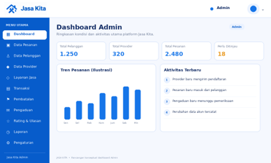

**Deskripsi:** Halaman utama setelah 
Admin berhasil masuk. 
Menampilkan ringkasan jumlah 
Customer, Provider, pesanan, dan 
aktivitas yang memerlukan 
perhatian.

**Tujuan:** Memberikan gambaran 
cepat kondisi platform dan pintasan 
menuju menu pengelolaan yang 
paling sering digunakan.

#### 3.1 Daftar Pesanan

**Deskripsi:** Halaman untuk melihat 
seluruh pesanan beserta ID, 
Customer, Provider, jenis layanan, 
dan status pesanan. Admin dapat 
mencari, menyaring, dan membuka 
detail pesanan.

**Tujuan:** Memudahkan pemantauan 
alur pesanan dan membantu Admin 
menemukan pesanan yang 
membutuhkan tindak lanjut.

#### 3.2 Detail Pesanan

**Deskripsi:** Halaman detail yang 
memperlihatkan pihak terkait, 
layanan, jadwal, alamat 
pengerjaan, status, serta riwayat 
pesanan.

**Tujuan:** Menyediakan informasi 
yang cukup saat Admin 
menelusuri pertanyaan, kendala, 
atau laporan terkait suatu pesanan.

---

#### 4.1 Daftar Pelanggan

**Deskripsi:** Halaman daftar 
pelanggan yang menampilkan 
identitas dasar, kontak, tanggal 
pendaftaran, dan status akun. 
Data contoh pada mockup bukan 
data pengguna sebenarnya.

**Tujuan:** Memudahkan Admin 
mencari dan mengawasi akun 
Customer secara terstruktur.

#### 4.2 Detail Pelanggan

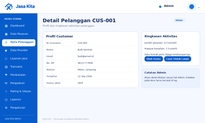

**Deskripsi:** Halaman profil pelanggan yang memuat informasi akun dan ringkasan aktivitas, termasuk pesanan atau laporan yang terkait.

**Tujuan:** Membantu Admin memeriksa informasi pelanggan ketika menangani pertanyaan, pengaduan, atau kebutuhan pembaruan data.

#### 4.3 Mengubah dan Memperbarui Data Pelanggan

**Deskripsi:** Halaman ini memungkinkan Admin mengubah dan memperbarui informasi data pelanggan, seperti nama, alamat email, nomor telepon, dan informasi akun lainnya apabila diperlukan.

**Tujuan:** Memudahkan Admin dalam memperbaiki atau memperbarui data pelanggan agar informasi akun tetap akurat, sesuai, dan terkelola dengan baik.

**Tujuan:** Membantu Admin 
memeriksa informasi pelanggan 
ketika menangani pertanyaan, 
pengaduan, atau kebutuhan 
pembaruan data.

#### 5.1 Daftar Provider

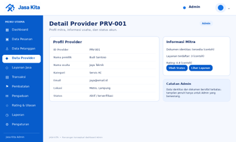

**Deskripsi:** Halaman yang 
menampilkan seluruh Provider 
beserta identitas, nama usaha, 
kategori jasa, lokasi, dan status 
akun.

**Tujuan:** Memudahkan Admin 
memantau mitra penyedia jasa 
dan menemukan akun yang 
perlu diverifikasi atau 
ditindaklanjuti.

---

#### 5.2 Detail Provider

**Deskripsi:** Halaman detail Provider yang menampilkan informasi lengkap mengenai identitas pemilik, informasi usaha, kategori jasa, lokasi, status akun, dokumen, serta layanan yang ditawarkan.

**Tujuan:** Membantu Admin memeriksa dan memperoleh informasi lengkap mengenai Provider sebagai dasar pemantauan serta pengelolaan akun penyedia jasa di platform Jasa Kita.

#### 6.1 Antrean Verifikasi Provider

**Deskripsi:** Halaman antrean 
pendaftaran Provider yang 
menampilkan status dokumen 
dan waktu pengajuan.

**Tujuan:** Membantu Admin 
memprioritaskan pengajuan yang 
belum diperiksa dan menjaga 
proses verifikasi tetap terpantau.

#### 6.2 Pemeriksaan Dokumen Provide

**Deskripsi:** Halaman untuk 
meninjau berkas Provider, 
mencatat hasil pemeriksaan, dan 
memilih keputusan verifikasi.

**Tujuan:** Memastikan akun 
mitra diperiksa secara konsisten 
serta setiap keputusan memiliki 
alasan dan jejak audit.

---

#### 7.1 Daftar Layanan Jasa

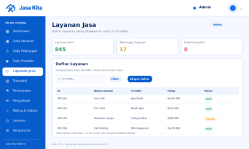

**Deskripsi:** Halaman daftar 
layanan berdasarkan nama jasa, 
Provider, harga, dan status 
publikasi.

**Tujuan:** Memberikan 
pengawasan terpusat terhadap 
layanan yang ditawarkan di Jasa 
Kita.

#### 7.2 Detail dan Moderasi Layanan

**Deskripsi:** Halaman detail untuk 
memeriksa isi layanan, harga, 
kategori, deskripsi, dan alasan 
layanan masuk antrean moderasi.

**Tujuan:** Menjaga informasi 
layanan tetap jelas dan sesuai 
ketentuan platform tanpa 
mengubah data secara 
sembarangan.

#### 8.1 Daftar Kategori Jasa

**Deskripsi:** Halaman untuk 
melihat dan mengelola daftar 
kategori layanan seperti servis 
AC, kelistrikan, kebersihan, 
dan bangunan.

#### Tujuan: Membuat
pengelompokan layanan lebih 
konsisten sehingga pencarian 
dan filter Customer mudah 
digunakan.

---

#### 8.2 Tambah / Ubah Kategori

**Deskripsi:** Formulir untuk 
menambahkan atau mengubah 
nama, deskripsi, ikon, dan status 
kategori jasa.

*****Tujuan****: Menjaga struktur 
kategori tetap rapi serta 
mengurangi kategori ganda atau 
membingungkan. 

##### 9.1 Riwayat Transaksi

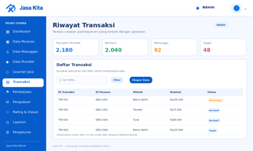

**Deskripsi:** Halaman daftar transaksi yang menghubungkan catatan pembayaran dengan ID pesanan, metode, nominal, waktu, dan status.

**Tujuan:** Memudahkan Admin 
menelusuri status transaksi dan 
mencocokkan catatan 
pembayaran dengan pesanan.

#### 9.2 Detail Transaksi

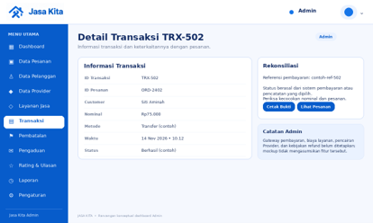

**Deskripsi:** Halaman detail 
transaksi untuk meninjau 
nominal, metode, waktu, status, 
dan referensi pembayaran yang 
terhubung ke pesanan.

**Tujuan:** Membantu 
pemeriksaan transaksi dan 
penelusuran selisih atau 
pertanyaan pembayaran.

---

#### 10.1 Daftar Pembatalan

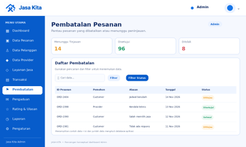

**Deskripsi:** Halaman untuk 
memantau permintaan dan 
riwayat pembatalan, termasuk 
pihak yang mengajukan, 
alasan, waktu, serta status 
penanganan.

**Tujuan:** Memastikan setiap 
pembatalan tercatat dan 
ditangani sesuai ketentuan 
yang berlaku.

#### 10.2 Detail Pembatalan

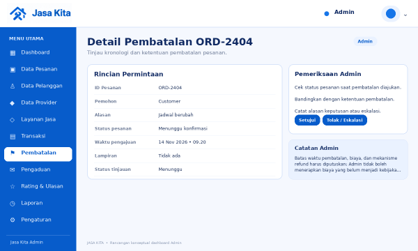

****Deskripsi****: Halaman untuk 
melihat kronologi pembatalan, 
status terakhir pesanan, alasan, 
serta bukti pendukung jika ada.

**Tujuan:** Membantu Admin 
menilai permintaan secara 
konsisten dan memberikan 
catatan keputusan yang dapat 
ditelusuri.

#### 11.1 Daftar Pengaduan

**Deskripsi:** Halaman untuk 
melihat laporan dari pengguna, 
pihak yang dilaporkan, 
kategori masalah, tanggal, dan 
status penanganan.

**Tujuan:** Membantu Admin 
mengatur antrean komplain 
dan memastikan laporan tidak 
terlewat.

---

#### 11.2 Detail dan Tindak Lanjut Pengaduan

****Deskripsi****: Halaman detail yang 
memuat kronologi, pihak terkait, 
bukti, serta catatan tindak lanjut 
pengaduan. 

****Tujuan****: Menyediakan proses 
penanganan komplain yang 
transparan, terdokumentasi, dan 
dapat ditelusuri. 

#### 12.1 Rating dan Ulasan

****Deskripsi****: Halaman untuk 
melihat rating dan komentar 
yang diberikan Customer 
terhadap layanan atau Provider. 

****Tujuan****: Membantu Admin 
memantau kualitas layanan dan 
meninjau ulasan yang dilaporkan 
atau ditandai.

#### 12.2 Pusat Notifikasi

**Deskripsi:** Halaman untuk 
memantau notifikasi yang 
tercatat, jenis pesan, penerima, 
dan status pengiriman

**Tujuan:** Membantu Admin 
memastikan pemberitahuan 
penting dapat dipantau dan 
gangguan pengiriman dapat 
ditelusuri.

---

#### 13.1 Laporan Pengguna dan Pesanan

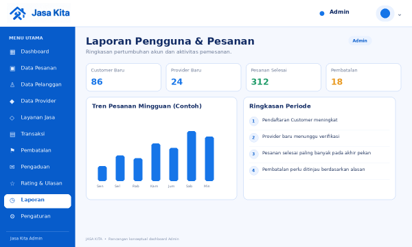

**Deskripsi:** Halaman laporan 
yang merangkum jumlah 
pengguna baru, Provider, 
pesanan, pesanan selesai, dan 
pembatalan dalam periode 
tertentu.

**Tujuan:** Memberikan bahan 
evaluasi aktivitas platform dan 
membantu pengelola melihat 
perubahan dari waktu ke waktu.

#### 13.2 Laporan Transaksi

**Deskripsi:** Halaman laporan 
untuk merangkum jumlah dan 
nilai transaksi berdasarkan 
rentang tanggal, metode, serta 
status.

**Tujuan:** Mendukung 
pemeriksaan keuangan dan 
evaluasi transaksi. Perhitungan 
komisi, pendapatan platform, 
dan pencairan Provider hanya 
ditambahkan jika model bisnis 
sudah ditetapkan.

#### 14.1 Pengaturan Sistem

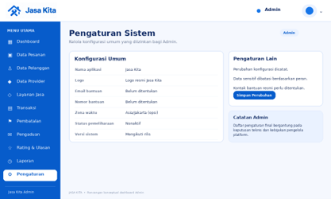.

**Deskripsi:** Halaman untuk 
mengatur informasi umum 
aplikasi dan konfigurasi yang 
memang disediakan untuk 
Admin.

**Tujuan:** Menjaga konfigurasi 
platform tetap terpusat dan 
perubahan penting dapat 
ditelusuri.

**Catatan keputusan:** Daftar 
pengaturan final bergantung 
pada keputusan teknis dan 
kebijakan pengelola platform.

---

#### 14.2 Manajemen Akun Admin

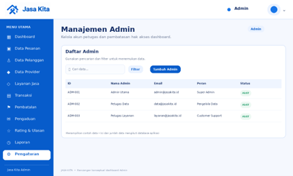

**Deskripsi:** Halaman untuk 
melihat akun petugas Admin, 
peran, dan status aksesnya.

**Tujuan:** Membatasi setiap 
petugas pada menu dan 
tindakan yang sesuai tanggung 
jawab. Rincian role dan izin 
akses perlu disepakati.

#### 15.1 Log Aktivitas Admin

**Deskripsi:** Halaman catatan 
aktivitas yang merekam siapa 
melakukan tindakan, kapan 
dilakukan, objek yang diubah, 
dan hasilnya.

**Tujuan:** Meningkatkan 
akuntabilitas, membantu audit, 
dan memudahkan penelusuran 
jika terjadi perubahan data.

#### 15.2 Profil Admin

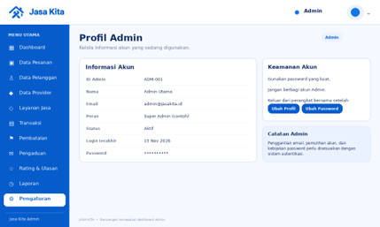

**Deskripsi:** Halaman untuk 
melihat dan memperbarui 
informasi dasar akun Admin 
serta mengakses pengaturan 
keamanan akun.

**Tujuan:** Memungkinkan 
Admin menjaga data akun 
tetap benar dan mengelola 
keamanan aksesnya.

---

#### 16.1 Konfirmasi Logout

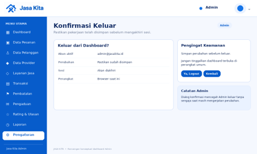

**Deskripsi:** Dialog konfirmasi 
yang muncul ketika Admin 
memilih menu Logout.

**Tujuan:** Mengurangi risiko 
sesi terputus tanpa sengaja 
dan mengingatkan Admin 
untuk menyimpan pekerjaan.

**Catatan keputusan:** Dialog 
konfirmasi mencegah Admin 
keluar tanpa sengaja saat 
masih mengerjakan 
perubahan.

#### 16.2 Kembali ke Halaman Login

**Deskripsi:** Halaman 
pemberitahuan bahwa sesi 
Admin telah ditutup dan 
akses dashboard tidak lagi 
aktif.

**Tujuan:** Memastikan proses 
logout jelas bagi pengguna 
serta mengakhiri sesi akses 
secara aman.
