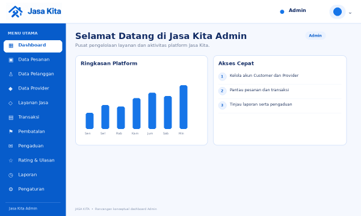
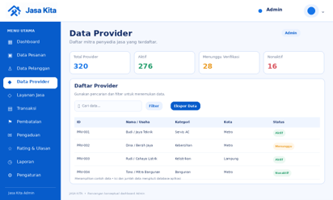
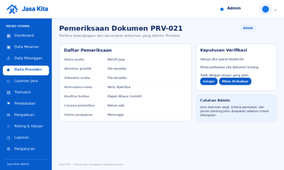

## JASA KITA | MOCKUP WEBSITE ADMIN

### 01. Akses Website Admin

#### 1.1 Halaman Awal Website Admin

**Deskripsi:** Halaman pembuka website 
khusus pengelola. Admin dapat 
mengenali identitas Jasa Kita dan 
menemukan akses menuju halaman 
masuk dashboard.

**Tujuan:** Memisahkan area administrasi 
dari aplikasi Customer dan Provider 
serta memberi titik masuk yang jelas 
bagi petugas yang berwenang.

#### 1.2 Login Admin

**Deskripsi:** Halaman autentikasi khusus 
Admin. Admin memasukkan 
email/username dan password yang 
sudah dibuat atau diberikan oleh 
pengelola sistem.

**Tujuan:** Membatasi akses dashboard 
hanya kepada akun Admin yang sah; 
pendaftaran Admin tidak dibuka untuk 
umum.

#### 2.1 Verifikasi Admin

**Deskripsi:** Halaman pemeriksaan 
tambahan setelah login, apabila sistem 
menerapkan OTP atau metode 
autentikasi berlapis.

**Tujuan:** Menambah perlindungan 
akun Admin. Metode, kanal 
pengiriman, masa berlaku, dan 
pemulihan akses masih perlu 
diputuskan.

#### 2.2 Dashboard Admin

**Deskripsi:** Halaman utama setelah 
Admin berhasil masuk. 
Menampilkan ringkasan jumlah 
Customer, Provider, pesanan, dan 
aktivitas yang memerlukan 
perhatian.

**Tujuan:** Memberikan gambaran 
cepat kondisi platform dan pintasan 
menuju menu pengelolaan yang 
paling sering digunakan.

#### 3.1 Daftar Pesanan

**Deskripsi:** Halaman untuk melihat 
seluruh pesanan beserta ID, 
Customer, Provider, jenis layanan, 
dan status pesanan. Admin dapat 
mencari, menyaring, dan membuka 
detail pesanan.

**Tujuan:** Memudahkan pemantauan 
alur pesanan dan membantu Admin 
menemukan pesanan yang 
membutuhkan tindak lanjut.

#### 3.2 Detail Pesanan

**Deskripsi:** Halaman detail yang 
memperlihatkan pihak terkait, 
layanan, jadwal, alamat 
pengerjaan, status, serta riwayat 
pesanan.

**Tujuan:** Menyediakan informasi 
yang cukup saat Admin 
menelusuri pertanyaan, kendala, 
atau laporan terkait suatu pesanan.

---

#### 4.1 Daftar Pelanggan

**Deskripsi:** Halaman daftar 
pelanggan yang menampilkan 
identitas dasar, kontak, tanggal 
pendaftaran, dan status akun. 
Data contoh pada mockup bukan 
data pengguna sebenarnya.

#### 4.2 Detail Pelanggan

**Tujuan:** Memudahkan Admin 
mencari dan mengawasi akun 
Customer secara terstruktur.

#### 4.3 Detail Pelanggan

**Deskripsi:** Halaman profil 
pelanggan yang memuat 
informasi akun dan ringkasan 
aktivitas, termasuk pesanan atau 
laporan yang terkait.

**Tujuan:** Membantu Admin 
memeriksa informasi pelanggan 
ketika menangani pertanyaan, 
pengaduan, atau kebutuhan 
pembaruan data.

#### 5.1 Daftar Provider

**Deskripsi:** Halaman yang 
menampilkan seluruh Provider 
beserta identitas, nama usaha, 
kategori jasa, lokasi, dan status 
akun.

**Tujuan:** Memudahkan Admin 
memantau mitra penyedia jasa 
dan menemukan akun yang 
perlu diverifikasi atau 
ditindaklanjuti.

---

#### 5.2 Detail Provider

**Deskripsi:** Halaman detail 
Provider untuk melihat identitas 
pemilik, informasi usaha, 
kategori, lokasi, dokumen, dan 
ringkasan layanan.

**Tujuan:** Menyediakan dasar 
pemeriksaan dan pemantauan 
mitra agar pengelolaan akun 
Provider lebih tertib.

#### 6.1 Antrean Verifikasi Provider

**Deskripsi:** Halaman antrean 
pendaftaran Provider yang 
menampilkan status dokumen 
dan waktu pengajuan.

**Tujuan:** Membantu Admin 
memprioritaskan pengajuan yang 
belum diperiksa dan menjaga 
proses verifikasi tetap terpantau.

#### 6.2 Pemeriksaan Dokumen Provide

**Deskripsi:** Halaman untuk 
meninjau berkas Provider, 
mencatat hasil pemeriksaan, dan 
memilih keputusan verifikasi.

**Tujuan:** Memastikan akun 
mitra diperiksa secara konsisten 
serta setiap keputusan memiliki 
alasan dan jejak audit.

---

#### 7.1 Daftar Layanan Jasa

**Deskripsi:** Halaman daftar 
layanan berdasarkan nama jasa, 
Provider, harga, dan status 
publikasi.

**Tujuan:** Memberikan 
pengawasan terpusat terhadap 
layanan yang ditawarkan di Jasa 
Kita.

#### 7.2 Detail dan Moderasi Layanan

**Deskripsi:** Halaman detail untuk 
memeriksa isi layanan, harga, 
kategori, deskripsi, dan alasan 
layanan masuk antrean moderasi.

**Tujuan:** Menjaga informasi 
layanan tetap jelas dan sesuai 
ketentuan platform tanpa 
mengubah data secara 
sembarangan.

#### 8.1 Daftar Kategori Jasa

**Deskripsi:** Halaman untuk 
melihat dan mengelola daftar 
kategori layanan seperti servis 
AC, kelistrikan, kebersihan, 
dan bangunan.

#### Tujuan: Membuat

pengelompokan layanan lebih 
konsisten sehingga pencarian 
dan filter Customer mudah 
digunakan.

---

#### 8.2 Tambah / Ubah Kategori

**Deskripsi:** Formulir untuk 
menambahkan atau mengubah 
nama, deskripsi, ikon, dan status 
kategori jasa.

##### 9.1 Riwayat Transaksi

**Deskripsi:** Halaman daftar transaksi yang menghubungkan catatan pembayaran dengan ID pesanan, metode, nominal, waktu, dan status.

**Tujuan:** Menjaga struktur 
kategori tetap rapi serta 
mengurangi kategori ganda atau 
membingungkan.

**Deskripsi:** Halaman daftar 
transaksi yang menghubungkan 
catatan pembayaran dengan ID 
pesanan, metode, nominal, 
waktu, dan status.

**Tujuan:** Memudahkan Admin 
menelusuri status transaksi dan 
mencocokkan catatan 
pembayaran dengan pesanan.

#### 9.2 Detail Transaksi

9.2  Detail Transaksi

Jasa Kita Admin

MENU UTAMA
Dashboard
Data Pesanan
Data Pelanggan
Data Provider
Layanan Jasa
Transaksi
Pembatalan
Pengaduan
Rating & Ulasan
Laporan
Pengaturan
Jasa Kita Admin

Detail Transaksi TRX-502
Admin
Informasi transaksi dan keterkaitannya dengan pesanan.

Informasi Transaksi
ID Transaksi TRX-502
ID Pesanan ORD-2402
Customer Siti Aminah
Nominal Rp75.000
Metode Transfer (contoh)
Waktu 14 Nov 2026 • 10.12
Status Berhasil (contoh)

Rekonsiliasi
Referensi pembayaran: contoh-ref-502
Status berasal dan sistem pembayaran atau pencatatan yang dipilh.
Perksa keccokan nominal dan pesanan.
Cetak Bukti Lihat Pesanan

Catatan Admin
Gateway pembayaran, biaya layanan, pencairan Provider, dan kebijakan refund belum ditetapkan; mockup tidak mengasumsikan fitur tersebut.

JASA KITA • Rencangan konseptual dashboard Admin

**Deskripsi:** Halaman detail 
transaksi untuk meninjau 
nominal, metode, waktu, status, 
dan referensi pembayaran yang 
terhubung ke pesanan.

**Tujuan:** Membantu 
pemeriksaan transaksi dan 
penelusuran selisih atau 
pertanyaan pembayaran.

---

#### 10.1 Daftar Pembatalan

10.1  Daftar Pembatalan

Jasa Kita Admin

MENU UTAMA
Dashboard
Data Pesanan
Data Pelanggan
Data Provider
Layanan Jasa
Transaksi
Pembatalan
Pengaduan
Rating & Ulasan
Laporan
Pengaturan
Jasa Kita Admin

Pembatalan Pesanan
Admin
Pantau pesanan yang dibatalkan atau menunggu peninjauan.

Menunggu Tinjaun
14
Disetuju
96
Ditolak
8

Daftar Pembatalan
Gunakan pencarian dan filter untuk menemukan data.
Cari data...
Filter
Filter Status

ID Pesanan
Pemohon
Alasan
Tanggal
Status
ORD-2404
Customer
Jadwal berubah
14 Nov 2026
Ditinjau
ORD-2398
Provider
Kendala teknis
13 Nov 2026
Disebutjui
ORD-2390
Customer
Salah memilih jasa
12 Nov 2026
Selesai
ORD-2381
Customer
Tidak ada respons
11 Nov 2026
Ditinjau
Menampilkan contoh data • lsi dan jamlah data mengikuti database aplikasi.

JASA KITA • Rancangan honeggetual dashboard Admin

**Deskripsi:** Halaman untuk 
memantau permintaan dan 
riwayat pembatalan, termasuk 
pihak yang mengajukan, 
alasan, waktu, serta status 
penanganan.

**Tujuan:** Memastikan setiap 
pembatalan tercatat dan 
ditangani sesuai ketentuan 
yang berlaku.

#### 10.2 Detail Pembatalan

10.2  Detail Pembatalan

Jasa Kita Admin

MENU UTAMA
Dashboard
Data Pesanan
Data Pelanggan
Data Provider
Layanan Jasa
Transaksi
Pembatalan
Pengaduan
Rating & Ulasan
Laporan
Pengaturan
Jasa Kita Admin

Detail Pembatalan ORD-2404
Admin
Tinjau kronologi dan ketentuan pembatalan pesanan.

Rincian Permintaan
ID Pesanan ORD-2404
Pemohon Customer
Alasan Jadwal berubah
Status pesanan Menunggu konfirmasi
Waktu pengajuan 14 Nov 2026 • 09.20
Lampiran Tidak ada
Status tinjauan Menunggu

Pemeriksaan Admin
Cek status pesanan saat pembatalan diajukan.
Bandingkan dengan ketentuan pembatalan.
Catat alasan keputusan atau eskalasi.
Setujui Tolak / Eskalasi

Catatan Admin
Batas waktu pembatalan, biaya, dan mekanisme refund harus diputuskan; Admin tidak boleh menerapkan biaya yang belum menjadi kebijaka...

**Deskripsi:** Halaman untuk 
melihat kronologi pembatalan, 
status terakhir pesanan, alasan, 
serta bukti pendukung jika ada.

**Tujuan:** Membantu Admin 
menilai permintaan secara 
konsisten dan memberikan 
catatan keputusan yang dapat 
ditelusuri.

#### 11.1 Daftar Pengaduan

11.1  Daftar Pengaduan

Jasa Kita Admin

MENU UTAMA
Dashboard
Data Pesanan
Data Pelanggan
Data Provider
Layanan Jasa
Transaksi
Pembatalan
Pengaduan
Rating & Ulasan
Laporan
Pengaturan
Jasa Kita Admin

Pengaduan dan Komplain
Admin
Daftar laporan yang dikirim pengguna Jasa Kita.

Baru
9
Diproses
16
Selesai
72

Daftar Pengaduan
Gunakan pencarian dan filter untuk menemukan data.
Cari data...
Filter Filter Laporan

ID Laporan Pelapor Terkait Kategori Status
CMP-101 Customer ORD-2401 Keterlambatan Baru
CMP-102 Provider CUS-002 Komunikasi Diproses
CMP-103 Customer PRV-021 Kualitas jasa Baru
CMP-104 Customer ORD-2380 Pembayaran Selesai

Menampilkan contah data • IaI dan jumah data mengikuti database epikiksi

JASA KITA • Rancangan konseptual dashboard Admin

**Deskripsi:** Halaman untuk 
melihat laporan dari pengguna, 
pihak yang dilaporkan, 
kategori masalah, tanggal, dan 
status penanganan.

**Tujuan:** Membantu Admin 
mengatur antrean komplain 
dan memastikan laporan tidak 
terlewat.

---

#### 11.2 Detail dan Tindak Lanjut Pengaduan

11.2  Detail dan Tindak Lanjut Pengaduan

Jasa Kita
Admin

MENU UTAMA
Dashboard
Data Pesanan
Data Pelanggan
Data Provider
Layanan Jasa
Transaksi
Pembatalan
Pengaduan
Rating & Ulasan
Laporan
Pengaturan
Jasa Kita Admin

Detail Pengaduan CMP-101
Admin
Tinjau laporan, bukti, dan catatan komunikasi terkait.

Informasi Pengaduan
ID Laporan CMP-101
Pelapor Customer / Budi Santoso
Terkait ORD-2401
Kategori Keterlambatan
Kronologi Provider belum tba
Lampiran Foto / bukti (jika ada)
Status Baru

Tindak Lanjut
Catat hasil komunikasi dengan phak terkait.
Minta informasi tambahan jika diperlukan.
Eskalasi jika belum dapat diselesaikan.
Tandai Diproses Tandai Selesai

Catatan Admin
Batas waktu respon, mekanisme mediasi, dan bentuk penyelesaan perlu disepakai sebagai SOP layanan.

**Deskripsi:** Halaman detail yang 
memuat kronologi, pihak terkait, 
bukti, serta catatan tindak lanjut 
pengaduan.

**Tujuan:** Menyediakan proses 
penanganan komplain yang 
transparan, terdokumentasi, dan 
dapat ditelusuri.

#### 12.1 Rating dan Ulasan

12.1  Rating dan Ulasan

Jasa Kita Admin

MENU UTAMA
Dashboard
Data Pesanan
Data Pelanggan
Data Provider
Layanan Jasa
Transaksi
Pembatalan
Pengaduan
Rating & Ulasan
Laporan
Pengaturan
Jasa Kita Admin

Rating & Ulasan
Admin
Pantau penilaian Customer terhadap layanan Provider.

Total Ulasan
1.840
Rata-rata Rating
4,7
Ditandai
6

Daftar Ulasan
Gunakan pencarian dan filter untuk menemukan data.
Cari data...
Filter
Tinjau Ulasan

Pengguna
Provider
Layanan
Rating
Status
Budi Santoso
Jaya Tekrik
Servis AC
5.0
Tampil
Sibi Aminah
Bersih Jaya
Cuci Sofa
4.0
Tampil
Andi Saputra
Cahaya Listrik
Perbaikan
2.0
Ditandal
Rina Putri
Mtra Bungunan
Cat Dinding
5.0
Tampil

Menanggilan cantoh data • lain dan jumlah data mengkuti database apikasi.

JASA KITA • Rancangan koneksi dashboard Admin

#### 12.2 Pusat Notifikasi

12.2  Pusat Notifikasi

Jasa Kita Admin

MENU UTAMA
Dashboard
Data Pesanan
Data Pelanggan
Data Provider
Layanan Jasa
Transaksi
Pembatalan
Pengaduan
Rating & Ulasan
Laporan
Pengaturan
Jasa Kita Admin

Pusat Notifikasi
Admin
Pantau pemberitahuan sistem untuk pengguna dan Admin.

Riwayat Notifikasi
Gunakan pencarian dan filter untuk menemukan data.
Cari data...
Filter
Buat Pengumuman

Waktu
Penerima
Jenis
Pesan
Status
09.15
Provider
Pesanan
Ada pesan baru
Torkinim
09.20
Customer
Status
Pesanan dikonfirmasi
Torkinim
10.05
Admin
Verifikasi
Provider menunggu tinjauan
Baru
10.20
Customer
Pengaduan
Laporan diterma
Torkinim

Menampilkan contah data • tai dan jumlah data mengikuti database aplikasi

JASA KITA • Rancangan konceptual dashboard Admin

**Deskripsi:** Halaman untuk 
melihat rating dan komentar 
yang diberikan Customer 
terhadap layanan atau Provider.

**Tujuan:** Membantu Admin
memantau kualitas layanan dan 
meninjau ulasan yang dilaporkan 
atau ditandai.

**Deskripsi:** Halaman untuk 
memantau notifikasi yang 
tercatat, jenis pesan, penerima, 
dan status pengiriman

**Tujuan:** Membantu Admin 
memastikan pemberitahuan 
penting dapat dipantau dan 
gangguan pengiriman dapat 
ditelusuri.

---

#### 13.1 Laporan Pengguna dan Pesanan

13.1  Laporan Pengguna dan Pesanan

Jasa Kita Admin

MENU UTAMA
Dashboard
Data Pesanan
Data Pelanggan
Data Provider
Layanan Jasa
Transaksi
Pembatalan
Pengaduan
Rating & Ulasan
Laporan
Pengaturan
Jasa Kita Admin

Laporan Pengguna & Pesanan
Admin
Ringkasan pertumbuhan akun dan aktivitas pemesanan.

Customer Baru
86
Provider Baru
24
Pesanan Selesai
312
Pembatalan
18

Tren Pesanan Minggu (Contoh)

Sen Sel Kab Kam Jum Sab Min

Ringkasan Periode
1 Pendaftaran Customer meningkat
2 Provider baru menunggu verifikasi
3 Pesanan selesai paling banyak pada akhir pekan
4 Pembatalan perlu ditinjau berdasarkan alasan

JASA KITA • Rancangan konsulta/dashboard Admin

**Deskripsi:** Halaman laporan 
yang merangkum jumlah 
pengguna baru, Provider, 
pesanan, pesanan selesai, dan 
pembatalan dalam periode 
tertentu.

**Tujuan:** Memberikan bahan 
evaluasi aktivitas platform dan 
membantu pengelola melihat 
perubahan dari waktu ke waktu.

#### 13.2 Laporan Transaksi

13.2  Laporan Transaksi

Jasa Kita Admin

MENU UTAMA
Dashboard
Data Pesanan
Data Pelanggan
Data Provider
Layanan Jasa
Transaksi
Pembatalan
Pengaduan
Rating & Ulasan
Laporan
Pengaturan
Jasa Kita Admin

Laporan Transaksi
Admin
Ringkasan nilai transaksi berdasarkan periode dan status.

Transaksi Berhasil
2.040
Menunggu
92
Gagal
48

Nilai Transaksi (Illustrasi)

Ringkasan Transaksi
1 Total nominal mengikuti catatan transaksi
2 Pisahkan transaksi berhasil dan gagal
3 Periksa transaksi yang belum terkonfirmasi
4 Ekspor laporan untuk kebutuhan administrasi

JASA KITA • Rancangan konseptual dashboard Admin

**Deskripsi:** Halaman laporan 
untuk merangkum jumlah dan 
nilai transaksi berdasarkan 
rentang tanggal, metode, serta 
status.

**Tujuan:** Mendukung 
pemeriksaan keuangan dan 
evaluasi transaksi. Perhitungan 
komisi, pendapatan platform, 
dan pencairan Provider hanya 
ditambahkan jika model bisnis 
sudah ditetapkan.

#### 14.1 Pengaturan Sistem

14.1  Pengaturan Sistem

Jasa Kita Admin

MENU UTAMA
Dashboard
Data Pesanan
Data Pelanggan
Data Provider
Layanan Jasa
Transaksi
Pembatalan
Pengaduan
Rating & Ulasan
Laporan
Pengaturan
Jasa Kita Admin

Pengaturan Sistem
Admin
Kelola konfigurasi umum yang dilizinkan bagi Admin.

Konfigurasi Umum
Nama aplikasi Jasa Kita
Logo Logo resmi jasa Kita
Email bantuan Belum ditentukan
Nomor bantuan Belum ditentukan
Zona waktu Asia/jakarta (opsi)
Status pemeliharaan Nonaktif
Versi sistem Mengikuti rilis

Pengaturan Lain
Perubahan konfigurasi dicatat.
Data sensitif dibatasikan berdasarkan peran.
Kontak bantuan resmi perlu ditentukan.
Simpan Perubahan

Catatan Admin
Daftar pengaturan final bergantung pada keputusan teknis dan kebijakan pengelola platform.

JASA KITA • Rancangan konfigurasi dashboard Admin.

**Deskripsi:** Halaman untuk 
mengatur informasi umum 
aplikasi dan konfigurasi yang 
memang disediakan untuk 
Admin.

**Tujuan:** Menjaga konfigurasi 
platform tetap terpusat dan 
perubahan penting dapat 
ditelusuri.

**Catatan keputusan:** Daftar 
pengaturan final bergantung 
pada keputusan teknis dan 
kebijakan pengelola platform.

---

#### 14.2 Manajemen Akun Admin

14.2  Manajemen Akun Admin

Jasa Kita Admin

MENU UTAMA
Dashboard
Data Pesanan
Data Pelanggan
Data Provider
Layanan Jasa
Transaksi
Pembatalan
Pengaduan
Rating & Ulasan
Laporan
Pengaturan
Jasa Kita Admin

Manajemen Admin Admin
Kelola akun petugas dan pembatasan hak akses dashboard.

Daftar Admin
Gunakan pencarian dan filter untuk menemukan data.
Filter Tambah Admin

ID Nama Admin Email Peran Status
ADM-001 Admin Utama admin@jasakita.id Super Admin Aktif
ADM-002 Petugas Data data@jasakita.id Pengelola Data Aktif
ADM-003 Petugas Layanan layanan@jasakita.id Customer Support Aktif

Menampilkan contoh data • lsi dan jumlah data mengikuti database aplikasi

JASA KITA • Rancangan konseptual dashboard Admin

**Deskripsi:** Halaman untuk 
melihat akun petugas Admin, 
peran, dan status aksesnya.

**Tujuan:** Membatasi setiap 
petugas pada menu dan 
tindakan yang sesuai tanggung 
jawab. Rincian role dan izin 
akses perlu disepakati.

#### 15.1 Log Aktivitas Admin

15.1  Log Aktivitas Admin

Jasa Kita Admin

MENU UTAMA
Dashboard
Data Pesanan
Data Pelanggan
Data Provider
Layanan Jasa
Transaksi
Pembatalan
Pengaduan
Rating & Ulasan
Laporan
Pengaturan
Jasa Kita Admin

Log Aktivitas Admin Admin
Riwayat tindakan penting yang dilakukan melalui dashboard.

Riwayat Aktivitas
Gunakan pencarian dan filter untuk menemukan data.
Cari data...
Filter Ekspor Log

Waktu Admin Aktivitas Objek Hasil
09.12 ADM-001 Menyetujui Provider PRV-021 Berhasil
09.24 ADM-002 Memperbarui Customer CUS-002 Berhasil
10.05 ADM-001 Meninjau pengaduan CMP-101 Diproses
10.20 ADM-003 Mengubah kategori CAT-02 Berhasil
Menampilkan contoh data • Isi dan jumlah data mengikuti database apikasi

JASA KITA • Rancangan lionseptual dashboard Admin

**Deskripsi:** Halaman catatan 
aktivitas yang merekam siapa 
melakukan tindakan, kapan 
dilakukan, objek yang diubah, 
dan hasilnya.

**Tujuan:** Meningkatkan 
akuntabilitas, membantu audit, 
dan memudahkan penelusuran 
jika terjadi perubahan data.

#### 15.2 Profil Admin

15.2  Profil Admin

Jasa Kita Admin

MENU UTAMA
Dashboard
Data Pesanan
Data Pelanggan
Data Provider
Layanan Jasa
Transaksi
Pembatalan
Pengaduan
Rating & Ulasan
Laporan
Pengaturan
Jasa Kita Admin

Profil Admin
Admin
Kelola informasi akun yang sedang digunakan.

Informasi Akun
ID Admin ADM-001
Nama Admin Utama
Email admin@jasakita.id
Peran Super Admin (contoh)
Status Aktif
Login terakhir 15 Nov 2026
Password ......

Keamanan Akun
Gunakan password yang kuat.
Jangan berbagi akun Admin.
Keluar dari perangkat bersama setelah
Ubah Profil Ubah Password

Catatan Admin
Penggantian email, pemulihan akun, dan
kebijakan password perlu disesuaikan dengan
sistem autentikasi.

JASA KITA • Rancangan konseptual dashboard Admin

**Deskripsi:** Halaman untuk 
melihat dan memperbarui 
informasi dasar akun Admin 
serta mengakses pengaturan 
keamanan akun.

**Tujuan:** Memungkinkan 
Admin menjaga data akun 
tetap benar dan mengelola 
keamanan aksesnya.

---

#### 16.1 Konfirmasi Logout

16.1  Konfirmasi Logout

Jasa Kita Admin

MENU UTAMA
Dashboard
Data Pesanan
Data Pelanggan
Data Provider
Layanan Jasa
Transaksi
Pembatalan
Pengaduan
Rating & Ulasan
Laporan
Pengaturan
Jasa Kita Admin

Konfirmasi Keluar
Admin
Pastikan pekerjaan telah disimpan sebelum mengakhiri sesi.

Keluar dari Dashboard?
Akun aktif admin@jasakita.id
Perubahan Pastikan sudah disimpan
Sesi Akan diakhiri
Perangkat Browser saat ini

Pengingat Keamanan
Simpan perubahan sebelum keluar.
Jangan tinggalkan dashboard terbuka di perangkat umum.
Ya, Logout Kembali

Catatan Admin
Dialog konfirmasi mencegah Admin keluar tanpa sengaja saat masih mengerjakan perubahan.

JASA KITA • Rancangan konceptual dashboard Admin

**Deskripsi:** Dialog konfirmasi 
yang muncul ketika Admin 
memilih menu Logout.

**Tujuan:** Mengurangi risiko 
sesi terputus tanpa sengaja 
dan mengingatkan Admin 
untuk menyimpan pekerjaan.

**Catatan keputusan:** Dialog 
konfirmasi mencegah Admin 
keluar tanpa sengaja saat 
masih mengerjakan 
perubahan.

#### 16.2 Kembali ke Halaman Login

16.2  Kembali ke Halaman Login

Jasa Kita Admin

MENU UTAMA
Dashboard
Data Pesanan
Data Pelanggan
Data Provider
Layanan Jasa
Transaksi
Pembatalan
Pengaduan
Rating & Ulasan
Laporan
Pengaturan
Jasa Kita Admin

Sesi Berakhir
Anda telah keluar dari dashboard Admin Jasa Kita.

Admin

Logout Berhasil
Status sesi Berakhir
Akun admin@jasakita.id
Akses dashboard Ditutup
Langkah berikutnya Login kembali jika diperlukan

Keamanan
Tombol kembali mengarah ke halaman login.
Sesi sebelumnya tidak lagi dapat digunakan.
Kembali ke Login

Catatan Admin
Perilaku penghapusan token/session mengikuti implementasi autentikasi yang dipilih.

JASA KITA • Rancangan lionseptual dashboard Admin

**Deskripsi:** Halaman 
pemberitahuan bahwa sesi 
Admin telah ditutup dan 
akses dashboard tidak lagi 
aktif.

**Tujuan:** Memastikan proses 
logout jelas bagi pengguna 
serta mengakhiri sesi akses 
secara aman.
