## JASA KITA | MOCKUP WEBSITE ADMIN

### 01. Akses Website Admin

#### 1.1 Halaman Awal Website Admin

**Deskripsi:** Halaman pembuka website 
khusus pengelola. Admin dapat 
mengenali identitas Jasa Kita dan 
menemukan akses menuju halaman 
masuk dashboard.

**Tujuan:** Memisahkan area administrasi 
dari aplikasi Customer dan Provider 
serta memberi titik masuk yang jelas 
bagi petugas yang berwenang.

#### 1.2 Login Admin

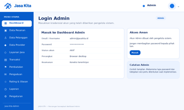

**Deskripsi:** Halaman autentikasi khusus 
Admin. Admin memasukkan 
email/username dan password yang 
sudah dibuat atau diberikan oleh 
pengelola sistem.

**Tujuan:** Membatasi akses dashboard 
hanya kepada akun Admin yang sah; 
pendaftaran Admin tidak dibuka untuk 
umum.

#### 2.1 Verifikasi Keamanan Admin

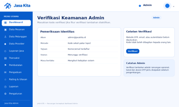

**Deskripsi:** Halaman ini menampilkan proses verifikasi identitas Admin setelah berhasil melakukan login. Sistem mengirimkan kode OTP (One-Time Password) ke alamat email yang terdaftar pada akun Admin. Halaman ini juga menampilkan informasi akun, alamat email tujuan, status verifikasi, dan masa berlaku kode OTP.

**Tujuan:** Memastikan bahwa pengguna yang melakukan login merupakan pemilik akun Admin yang sah melalui verifikasi kode OTP menggunakan email, sehingga keamanan akses menuju dashboard dan fitur pengelolaan website Jasa Kita lebih terjaga.

#### 2.2 Dashboard Admin

**Deskripsi:** Halaman utama setelah 
Admin berhasil masuk. 
Menampilkan ringkasan jumlah 
Customer, Provider, pesanan, dan 
aktivitas yang memerlukan 
perhatian.

**Tujuan:** Memberikan gambaran 
cepat kondisi platform dan pintasan 
menuju menu pengelolaan yang 
paling sering digunakan.

#### 3.1 Daftar Pesanan

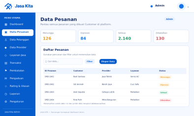

**Deskripsi:** Halaman untuk melihat 
seluruh pesanan beserta ID, 
Customer, Provider, jenis layanan, 
dan status pesanan. Admin dapat 
mencari, menyaring, dan membuka 
detail pesanan.

**Tujuan:** Memudahkan pemantauan 
alur pesanan dan membantu Admin 
menemukan pesanan yang 
membutuhkan tindak lanjut.

#### 3.2 Detail Pesanan

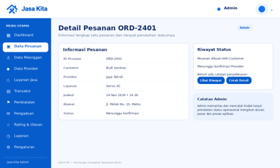

**Deskripsi:** Halaman detail yang 
memperlihatkan pihak terkait, 
layanan, jadwal, alamat 
pengerjaan, status, serta riwayat 
pesanan.

**Tujuan:** Menyediakan informasi 
yang cukup saat Admin 
menelusuri pertanyaan, kendala, 
atau laporan terkait suatu pesanan.

---

#### 4.1 Daftar Pelanggan

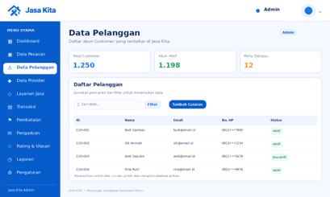

**Deskripsi:** Halaman daftar 
pelanggan yang menampilkan 
identitas dasar, kontak, tanggal 
pendaftaran, dan status akun. 
Data contoh pada mockup bukan 
data pengguna sebenarnya.

**Tujuan:** Memudahkan Admin 
mencari dan mengawasi akun 
Customer secara terstruktur.

#### 4.2 Detail Pelanggan

**Deskripsi:** Halaman profil pelanggan yang memuat informasi akun dan ringkasan aktivitas, termasuk pesanan atau laporan yang terkait.

**Tujuan:** Membantu Admin memeriksa informasi pelanggan ketika menangani pertanyaan, pengaduan, atau kebutuhan pembaruan data.

#### 4.3 Mengubah dan Memperbarui Data Pelanggan

**Deskripsi:** Halaman ini memungkinkan Admin mengubah dan memperbarui informasi data pelanggan, seperti nama, alamat email, nomor telepon, dan informasi akun lainnya apabila diperlukan.

**Tujuan:** Memudahkan Admin dalam memperbaiki atau memperbarui data pelanggan agar informasi akun tetap akurat, sesuai, dan terkelola dengan baik.

**Tujuan:** Membantu Admin 
memeriksa informasi pelanggan 
ketika menangani pertanyaan, 
pengaduan, atau kebutuhan 
pembaruan data.

#### 5.1 Daftar Provider

**Deskripsi:** Halaman yang 
menampilkan seluruh Provider 
beserta identitas, nama usaha, 
kategori jasa, lokasi, dan status 
akun.

**Tujuan:** Memudahkan Admin 
memantau mitra penyedia jasa 
dan menemukan akun yang 
perlu diverifikasi atau 
ditindaklanjuti.

---

#### 5.2 Detail Provider

**Deskripsi:** Halaman detail Provider yang menampilkan informasi lengkap mengenai identitas pemilik, informasi usaha, kategori jasa, lokasi, status akun, dokumen, serta layanan yang ditawarkan.

**Tujuan:** Membantu Admin memeriksa dan memperoleh informasi lengkap mengenai Provider sebagai dasar pemantauan serta pengelolaan akun penyedia jasa di platform Jasa Kita.

#### 6.1 Antrean Verifikasi Provider

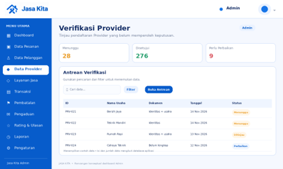

**Deskripsi:** Halaman ini menampilkan daftar pengajuan verifikasi Provider yang belum diperiksa oleh Admin, termasuk informasi identitas Provider, status dokumen, dan waktu pengajuan verifikasi.

**Tujuan:** Memudahkan Admin memantau dan mengelola antrean pengajuan verifikasi Provider serta menentukan pengajuan yang perlu diperiksa lebih lanjut.

#### 6.2 Pemeriksaan Dokumen Provider

**Deskripsi:** Halaman ini memungkinkan Admin memeriksa dokumen identitas dan dokumen pendukung yang telah diunggah oleh Provider. Setelah melakukan pemeriksaan, Admin dapat menentukan salah satu dari tiga keputusan, yaitu menyetujui dokumen, menolak pengajuan verifikasi, atau meminta Provider melakukan perbaikan dokumen. Setiap keputusan disertai catatan atau alasan sebagai informasi bagi Provider.

**Tujuan:** Memastikan proses verifikasi dokumen Provider berjalan secara teliti, transparan, dan terstruktur sehingga hanya Provider yang memenuhi persyaratan yang dapat disetujui untuk menawarkan layanan jasa di aplikasi Jasa Kita.

---

#### 7.1 Daftar Layanan Jasa

**Deskripsi:** Halaman daftar 
layanan berdasarkan nama jasa, 
Provider, harga, dan status 
publikasi.

**Tujuan:** Memberikan 
pengawasan terpusat terhadap 
layanan yang ditawarkan di Jasa 
Kita.

#### 7.2 Detail dan Moderasi Layanan

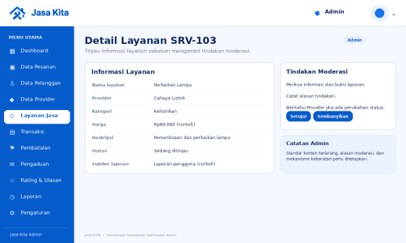

**Deskripsi:** Halaman ini memungkinkan Admin memeriksa informasi layanan yang dibuat oleh Provider, meliputi nama layanan, kategori, harga, deskripsi, dan informasi pendukung lainnya. Setelah melakukan pemeriksaan, Admin dapat menentukan salah satu dari tiga keputusan, yaitu menyetujui layanan agar dapat ditampilkan kepada Customer, meminta Provider melakukan perbaikan, atau menolak layanan yang tidak memenuhi ketentuan. Setiap keputusan disertai catatan atau alasan sebagai informasi bagi Provider.

**Tujuan:** Memastikan setiap layanan yang ditampilkan di platform Jasa Kita memiliki informasi yang jelas, sesuai ketentuan, dan layak ditawarkan kepada Customer.

#### 8.1 Daftar Kategori Jasa

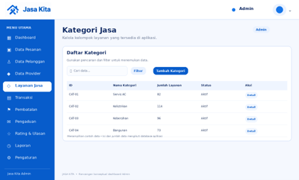

**Deskripsi:** Halaman ini menampilkan daftar kategori layanan yang tersedia di platform Jasa Kita, seperti servis AC, kelistrikan, kebersihan, dan bangunan. Admin dapat melihat serta mengelola kategori yang digunakan untuk mengelompokkan layanan.

***Tujuan:** Memudahkan Admin mengelola kategori jasa agar pengelompokan layanan tetap konsisten sehingga fitur pencarian dan filter oleh Customer dapat digunakan dengan lebih mudah.

#### 8.2 Tambah / Ubah Kategori

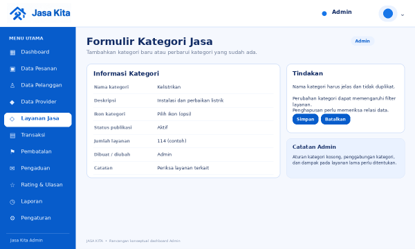

**Deskripsi:** Formulir yang digunakan Admin untuk menambahkan kategori baru atau mengubah informasi kategori yang sudah tersedia, seperti nama, deskripsi, ikon, dan status kategori.

**Tujuan:** Memudahkan Admin mengelola struktur kategori jasa agar tetap rapi, konsisten, dan mengurangi kemungkinan adanya kategori ganda atau membingungkan.

#### 9.1 Riwayat Transaksi

**Deskripsi:** Halaman ini menampilkan daftar seluruh transaksi pembayaran yang terjadi di platform Jasa Kita, meliputi ID transaksi, ID pesanan, nama Customer, nama Provider, tanggal transaksi, metode pembayaran, nominal, dan status pembayaran. Admin dapat mencari, menyaring, serta membuka detail transaksi.

**Tujuan:** Memudahkan Admin memantau seluruh aktivitas transaksi pembayaran dan menemukan transaksi yang membutuhkan pemeriksaan atau tindak lanjut.

#### 9.2 Detail Transaksi

**Deskripsi:** Halaman ini menampilkan informasi lengkap mengenai transaksi yang dipilih, meliputi ID transaksi, ID pesanan, informasi Customer dan Provider, nominal pembayaran, metode pembayaran, waktu transaksi, status pembayaran, serta nomor referensi dari penyedia layanan pembayaran.

**Tujuan:** Membantu Admin memeriksa keabsahan informasi transaksi, menelusuri status pembayaran, dan menangani kendala atau pertanyaan terkait pembayaran.

---

#### 10.1 Daftar Pembatalan

**Deskripsi:** Halaman ini menampilkan daftar permintaan dan riwayat pembatalan pesanan, meliputi ID pembatalan, ID pesanan, nama Customer, nama Provider, pihak yang mengajukan pembatalan, alasan, tanggal pengajuan, serta status penanganan. Admin dapat mencari, menyaring, dan membuka detail pembatalan.

**Tujuan:** Memudahkan Admin memantau seluruh aktivitas pembatalan pesanan serta menemukan permintaan yang membutuhkan pemeriksaan atau tindak lanjut.

#### 10.2 Detail Pembatalan

**Deskripsi:** Halaman ini menampilkan informasi lengkap mengenai permintaan pembatalan pesanan, meliputi identitas Customer dan Provider, detail pesanan, pihak yang mengajukan pembatalan, alasan pembatalan, kronologi pesanan, serta bukti pendukung jika tersedia. Admin dapat memeriksa alasan pembatalan dan menentukan apakah pengajuan tersebut layak disetujui atau ditolak. Apabila disetujui, sistem secara otomatis memperbarui status pesanan menjadi dibatalkan.

**Tujuan:** Membantu Admin memastikan setiap permintaan pembatalan diperiksa berdasarkan alasan yang jelas serta memastikan proses pembatalan berjalan secara terstruktur dan tercatat dalam sistem.

#### 11.1 Daftar Pengaduan

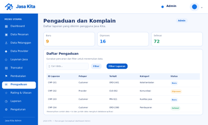

**Deskripsi:** Halaman ini menampilkan seluruh pengaduan yang dikirimkan oleh pengguna Jasa Kita, baik Customer maupun Provider. Informasi yang ditampilkan meliputi ID pengaduan, nama pelapor, pihak yang dilaporkan, kategori pengaduan, tanggal laporan, dan status penanganan. Admin dapat mencari, menyaring, serta membuka detail pengaduan.

**Tujuan:** Memudahkan Admin memantau seluruh pengaduan yang masuk, mengelompokkan laporan berdasarkan kategori, dan menemukan pengaduan yang membutuhkan tindak lanjut.

---

#### 11.2 Detail dan Tindak Lanjut Pengaduan

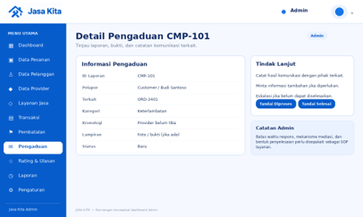

**Deskripsi:** Halaman ini menampilkan informasi lengkap mengenai pengaduan, meliputi identitas pelapor, pihak yang dilaporkan, kategori pengaduan, kronologi kejadian, bukti pendukung, serta riwayat penanganan. Admin dapat memeriksa laporan, memberikan catatan hasil pemeriksaan, memperbarui status penanganan, serta menentukan tindakan terhadap pengguna yang terbukti melakukan pelanggaran, seperti memberikan peringatan, pembatasan sementara, penangguhan, atau pemblokiran akun.

**Tujuan:** Membantu Admin menangani pengaduan Customer maupun Provider secara terstruktur, transparan, dan terdokumentasi serta menjaga keamanan dan kepercayaan pengguna melalui pemberian sanksi sesuai tingkat pelanggaran.

#### 12.1 Rating dan Ulasan

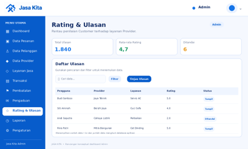

**Deskripsi:** Halaman ini menampilkan seluruh rating dan ulasan yang diberikan Customer terhadap Provider atau layanan setelah pesanan selesai. Informasi yang ditampilkan meliputi nama Customer, Provider, layanan yang dinilai, ID pesanan, nilai rating, komentar, tanggal ulasan, serta status ulasan. Admin dapat memantau dan menindaklanjuti ulasan yang dilaporkan atau terindikasi melanggar ketentuan platform.

**Tujuan:** Membantu Admin memantau kualitas layanan, menjaga kepercayaan pengguna, serta memastikan ulasan yang ditampilkan di platform Jasa Kita tetap sesuai dengan ketentuan yang berlaku.

#### 12.2 Pusat Notifikasi

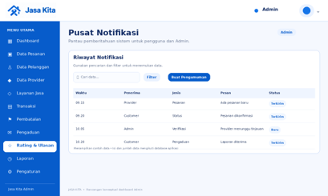

**Deskripsi:** Halaman ini menampilkan daftar notifikasi yang dikirimkan oleh sistem kepada Customer dan Provider. Informasi yang ditampilkan meliputi jenis notifikasi, penerima, isi pesan, waktu pengiriman, serta status pengiriman. Admin dapat memantau riwayat notifikasi dan memeriksa notifikasi yang mengalami kegagalan pengiriman.

**Tujuan:** Memudahkan Admin memantau aktivitas pemberitahuan sistem, memastikan informasi penting tersampaikan kepada pengguna, serta membantu menelusuri kendala pengiriman notifikasi.

---

#### 13.1 Laporan Pengguna dan Pesanan

**Deskripsi:** Halaman ini menampilkan laporan aktivitas pengguna dan pesanan pada platform Jasa Kita dalam periode tertentu. Informasi yang disajikan meliputi jumlah Customer dan Provider, pengguna baru, total pesanan, pesanan berdasarkan status, pesanan selesai, serta pesanan yang dibatalkan. Admin dapat menyaring laporan berdasarkan rentang tanggal, melihat ringkasan data melalui grafik maupun tabel, serta mengunduh laporan dalam format PDF atau Excel.

**Tujuan:** Memberikan informasi mengenai perkembangan jumlah pengguna dan aktivitas pesanan sebagai bahan evaluasi Admin dalam memantau perkembangan platform Jasa Kita. Fitur unduh laporan juga memudahkan penyimpanan dan penyusunan dokumentasi data.

#### 13.2 Laporan Transaksi

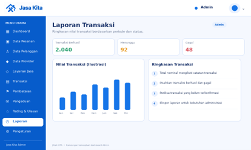

**Deskripsi:** Halaman ini menampilkan laporan transaksi pembayaran yang terjadi di platform Jasa Kita dalam periode tertentu. Informasi yang disajikan meliputi jumlah transaksi, total nominal transaksi, metode pembayaran, waktu transaksi, serta status pembayaran seperti menunggu, berhasil, gagal, atau dikembalikan. Halaman ini juga menampilkan perhitungan komisi yang diperoleh platform dan pendapatan bersih Provider setelah dikurangi komisi. Admin dapat menyaring laporan berdasarkan rentang tanggal dan status transaksi serta mengunduh laporan dalam format PDF atau Excel.

**Tujuan:** Memudahkan Admin memantau aktivitas pembayaran, mengetahui pendapatan komisi platform, memantau pendapatan Provider, serta mengevaluasi transaksi yang membutuhkan pemeriksaan atau tindak lanjut.

#### 14.1 Pengaturan Sistem

.

**Deskripsi:** Halaman untuk 
mengatur informasi umum 
aplikasi dan konfigurasi yang 
memang disediakan untuk 
Admin.

**Tujuan:** Menjaga konfigurasi 
platform tetap terpusat dan 
perubahan penting dapat 
ditelusuri.

**Catatan keputusan:** Daftar 
pengaturan final bergantung 
pada keputusan teknis dan 
kebijakan pengelola platform.

---

#### 14.2 Manajemen Akun Admin

**Deskripsi:** Halaman untuk 
melihat akun petugas Admin, 
peran, dan status aksesnya.

**Tujuan:** Membatasi setiap 
petugas pada menu dan 
tindakan yang sesuai tanggung 
jawab. Rincian role dan izin 
akses perlu disepakati.

#### 15.1 Log Aktivitas Admin

**Deskripsi:** Halaman catatan 
aktivitas yang merekam siapa 
melakukan tindakan, kapan 
dilakukan, objek yang diubah, 
dan hasilnya.

**Tujuan:** Meningkatkan 
akuntabilitas, membantu audit, 
dan memudahkan penelusuran 
jika terjadi perubahan data.

#### 15.2 Profil Admin

**Deskripsi:** Halaman untuk 
melihat dan memperbarui 
informasi dasar akun Admin 
serta mengakses pengaturan 
keamanan akun.

**Tujuan:** Memungkinkan 
Admin menjaga data akun 
tetap benar dan mengelola 
keamanan aksesnya.

---

#### 16.1 Konfirmasi Logout

**Deskripsi:** Dialog konfirmasi 
yang muncul ketika Admin 
memilih menu Logout.

**Tujuan:** Mengurangi risiko 
sesi terputus tanpa sengaja 
dan mengingatkan Admin 
untuk menyimpan pekerjaan.

**Catatan keputusan:** Dialog 
konfirmasi mencegah Admin 
keluar tanpa sengaja saat 
masih mengerjakan 
perubahan.

#### 16.2 Kembali ke Halaman Login

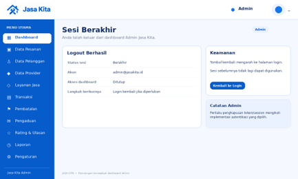

**Deskripsi:** Halaman 
pemberitahuan bahwa sesi 
Admin telah ditutup dan 
akses dashboard tidak lagi 
aktif.

**Tujuan:** Memastikan proses 
logout jelas bagi pengguna 
serta mengakhiri sesi akses 
secara aman.
