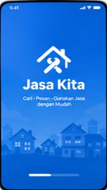
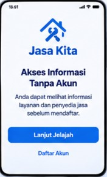
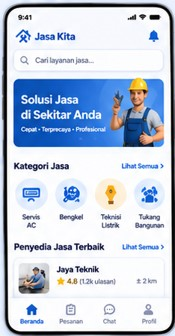
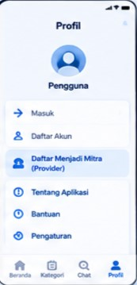
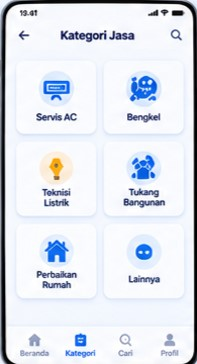
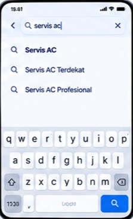
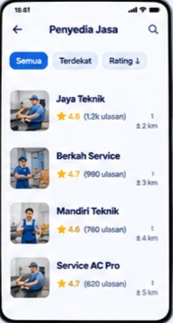
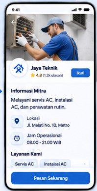
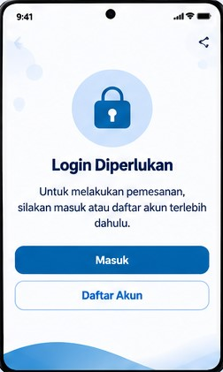

## Guest (Pengunjung)

**9 fitur**

Guest merupakan pengguna yang membuka aplikasi tetapi belum memiliki akun atau belum login. 
Guest dapat mengakses informasi umum dan melihat layanan yang tersedia sebelum memutuskan 
untuk mendaftar.

### 1. Halaman Splash Screen

**Deskripsi :** Memberikan kesan awal Aplikasi.

**Tujuan :** Menampilkan Logo dan nama Aplikasi

### 2. Halaman Akses Tanpa Akun

**Deskripsi :** Memberikan akses informasi meski belum login.

**Tujuan :** tampilkan status sebagai Pengunjung serta pilihan Masuk dan Daftar Akun.

### 3. Fitur Melihat Halaman Utama Aplikasi

**Deskripsi:** Fitur ini memungkinkan Guest melihat halaman utama 
aplikasi Jasa Kita yang berisi informasi umum mengenai aplikasi dan 
layanan yang tersedia.

**Tujuan:** Memberikan gambaran awal kepada pengunjung mengenai 
fungsi dan layanan yang ditawarkan oleh aplikasi Jasa Kita.

### 4. Fitur Halaman Profile

**Deskripsi:** Fitur ini untuk mengakses menu akun dan daftar akun

**Tujuan:** Membantu pengunjung untuk melihat profil

---

**5. Fitur Melihat Daftar Kategori Jasa**

**Deskripsi:** Fitur ini memungkinkan Guest melihat berbagai 
kategori layanan jasa yang tersedia, seperti servis AC, bengkel, 
teknisi listrik, tukang bangunan, dan perbaikan rumah.

**Tujuan:** Membantu pengunjung mengetahui jenis layanan 
yang dapat ditemukan melalui aplikasi.

### 6. Tampilan Fitur Pencarian

**Deskripsi:** Halaman Filter bertujuan membantu Guest 
mempersempit hasil pencarian penyedia jasa berdasarkan 
kriteria tertentu, sehingga pengunjung dapat menemukan 
Provider yang lebih sesuai dengan kebutuhan dan lokasi 
pekerjaan.

**Tujuan:** Filter berdasarkan kategori, lokasi, dan rating

---

### 7. Fitur Melihat Daftar Penyedia Jasa

**Deskripsi:** Fitur ini memungkinkan Guest melihat daftar Penyedia 
Jasa atau mitra yang menawarkan layanan jasa melalui aplikasi Jasa 
Kita.

**Tujuan:** Memberikan informasi kepada pengunjung mengenai 
penyedia jasa yang tersedia sebelum melakukan pendaftaran.

### 8. Fitur Melihat Detail Informasi Penyedia Jasa

**Deskripsi:** Fitur ini memungkinkan Guest melihat informasi lebih 
lanjut mengenai penyedia jasa, termasuk identitas dan layanan 
yang ditawarkan.

**Tujuan:** Membantu pengunjung mempertimbangkan penyedia 
jasa yang sesuai dengan kebutuhan sebelum membuat akun.

### 9. Tampilan Wajib Login

**Deskripsi:** Fitur ini menampilkan halaman pemberitahuan kepada Guest bahwa pengguna harus masuk menggunakan akun yang telah terdaftar atau membuat akun baru sebelum dapat melakukan pemesanan jasa melalui aplikasi Jasa Kita.

**Tujuan:** Membatasi akses terhadap fitur pemesanan agar hanya pengguna yang telah memiliki akun dan terautentikasi yang dapat melakukan pemesanan, serta memastikan data Customer dapat tercatat dan dikelola dengan baik oleh sistem.
