## Customer (Pelanggan)

**20 fitur**

Customer merupakan pengguna yang telah memiliki akun dan melakukan login ke aplikasi Jasa 
Kita. Customer dapat mencari layanan, melakukan pemesanan, berkomunikasi dengan Provider, 
serta memberikan penilaian.

### 1. Halaman Slpash Screen

**Deskripsi :** Memberikan kesan awal Aplikasi.

**Tujuan :** Menampilkan Logo dan nama Aplikasi

### 2. Fitur Mendaftar dan Login

**Deskripsi:** Fitur ini memungkinkan Customer membuat akun baru 
dan masuk ke aplikasi menggunakan akun yang telah terdaftar.

**Tujuan:** Memberikan akses kepada pengguna untuk menggunakan 
fitur-fitur aplikasi yang memerlukan autentikasi.

**Note :** Pelanggan dapat masuk menggunakan email atau nomor HP 
dan kata sandi. Pengguna yang belum memiliki akun dapat memilih 
menu Daftar Akun. Tersedia pula pilihan Lupa Password

---

### 3. Halaman Pendaftaran Akun

**Deskripsi :** Halaman untuk masuk menggunakan akun yang sudah 
dimiliki atau melakukan pendaftaran akun baru sebagai Customer 
dengan mengisi informasi yang diperlukan.

**Tujuan :** Memberikan akses kepada pembeli agar dapat menggunakan 
fitur transaksi, pemesanan jasa, komunikasi, serta pengelolaan 
aktivitas akun.

**Deskripsi :** Tahapan pemeriksaan identitas atau kode verifikasi yang 
dikirimkan kepada pengguna melalui metode verifikasi yang 
disediakan aplikasi.

### 4. Verifikasi Akun

**Tujuan :** Memastikan bahwa akun didaftarkan menggunakan 
informasi kontak yang valid serta membantu menjaga keamanan akun 
pengguna.

---

### 5. Pengisian data diri

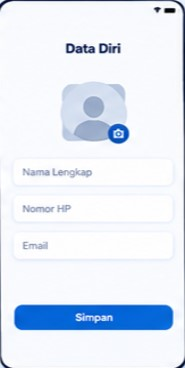

**Deskripsi :** Halaman untuk melengkapi informasi pribadi Customer, 
seperti nama lengkap, nomor telepon, alamat, dan informasi 
pendukung lainnya.

**Tujuan :** Melengkapi profil pembeli agar penyedia jasa dapat 
mengenali pelanggan dan mengetahui informasi yang diperlukan 
ketika menerima pesanan.

### 6. Fitur Beranda Customer

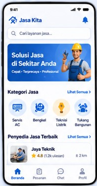

**Deskripsi:** Fitur ini memungkinkan Customer melihat berbagai 
kategori layanan jasa yang tersedia, seperti servis AC, teknisi 
listrik, bengkel, dan perbaikan rumah.

**Tujuan:** Memudahkan Customer menemukan kategori layanan 
sesuai kebutuhan.

**Note** : Beranda menampilkan kolom pencarian, kategori jasa, 
serta rekomendasi penyedia jasa. Pelanggan dapat mulai 
mencari layanan dari kategori yang tersedia atau melihat 
penyedia jasa yang ditampilkan.

---

### 7. Tampilan Fitur Melihat Daftar Ktegori Jasa

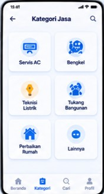

**Deskripsi:** Fitur ini memungkinkan Guest melihat berbagai 
kategori layanan jasa yang tersedia, seperti servis AC, bengkel, 
teknisi listrik, tukang bangunan, dan perbaikan rumah.

**Tujuan:** Membantu pengunjung mengetahui jenis layanan yang 
dapat ditemukan melalui aplikasi.

### 8. Fitur Mencari Penyedia Jasa Berdasarkan Nama atau Kategori

**Deskripsi:** Fitur ini memungkinkan Customer mencari penyedia 
jasa menggunakan nama mitra atau kategori layanan tertentu 
melalui fitur pencarian.

**Tujuan:** Mempermudah Customer menemukan penyedia jasa 
yang sesuai tanpa harus mencari satu per satu secara manual.

**Note :** Pelanggan dapat mencari layanan atau nama mitra melalui 
kolom pencarian. Hasil pencarian dapat disaring berdasarkan 
lokasi dan kategori agar daftar penyedia jasa lebih relevan.

---

### 9. Tampilan Fitur Memfilter Penyedia Jasa Berdasarkan Lokasi

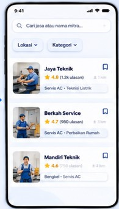

**Deskripsi:** Fitur ini memungkinkan Customer menyaring daftar 
penyedia jasa berdasarkan lokasi untuk menemukan mitra yang 
berada di sekitar lokasi yang dibutuhkan.

**Tujuan:** Membantu Customer menemukan penyedia jasa yang 
lokasinya sesuai dengan kebutuhan pekerjaan.

### 10. Tampilan Fitur Memasukkan Detail Kebutuhan dan Lokasi Pekerjaan

**Deskripsi:** Fitur ini memungkinkan Customer memasukkan 
informasi mengenai kebutuhan pekerjaan serta lokasi tempat 
layanan akan dilakukan.

**Tujuan:** Membantu Provider memahami jenis pekerjaan dan 
mengetahui lokasi pekerjaan sebelum menerima pesanan.

---

### 11. Fitur Melihat Profil dan Informasi Layanan Mitra

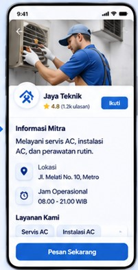

**Deskripsi:** Fitur ini memungkinkan Customer melihat informasi 
profil Provider seperti Lokasi  Jam operasinal beserta layanan jasa 
yang ditawarkan.

**Tujuan:** Memberikan informasi kepada Customer agar dapat 
mempertimbangkan mitra sebelum melakukan pemesanan.

### 12. Fitur Membuat Pemesanan Jasa

**Deskripsi:** Fitur ini memungkinkan Customer mengirimkan 
permintaan pemesanan layanan kepada Provider yang telah 
dipilih melalui aplikasi.

**Tujuan:** Mempermudah proses pemesanan jasa tanpa harus 
mencari penyedia jasa secara langsung

Contoh: AC tidak dingin,
mohon dicek.

---

### 13. Tampilan Pesanan dibuat

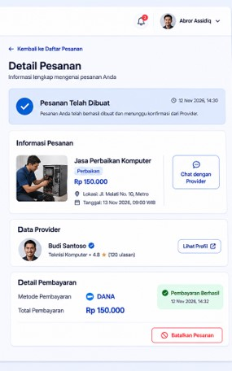

### 14. Tampilan Pesanan di proses

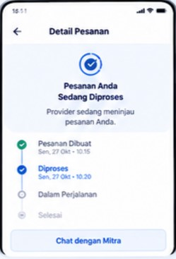

**Deskripsi :** Menampilkan konfirmasi bahwa pesanan 
layanan berhasil dibuat oleh pelanggan, beserta informasi 
layanan, jadwal, lokasi, Provider, dan status pesanan.

**Tujuan:** Memberikan kepastian kepada pelanggan bahwa 
pesanan telah tercatat dalam sistem serta memudahkan 
pelanggan memantau status pesanan hingga layanan 
selesai.

---

### 15.Fitur Mengirim Pesan kepada Mitra melalui Chat

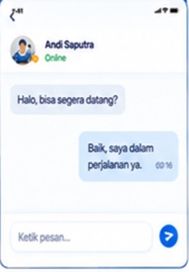

**Deskripsi:** Fitur ini memungkinkan Customer 
berkomunikasi secara langsung dengan Provider 
melalui fitur chat untuk membahas kebutuhan dan 
detail pekerjaan.

**Tujuan:** Mempermudah komunikasi antara Customer 
dan Provider agar informasi pekerjaan dapat 
disampaikan dengan jelas.

## 16.Fitur Membatalkan Pesanan Sesuai Ketentuan

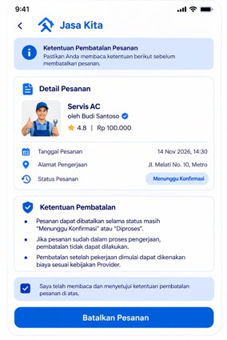

**Deskripsi:** Fitur ini memungkinkan Customer 
membatalkan permintaan pemesanan apabila tidak 
jadi menggunakan layanan, dengan mengikuti 
ketentuan yang berlaku.

**Tujuan:** Memberikan fleksibilitas kepada Customer 
apabila terjadi perubahan kebutuhan terhadap 
layanan yang telah dipesan.

---

### 17. Tampilan Pesanan Di Terima Oleh Pprovider

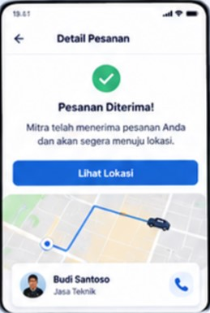

**Deskripsi :** Halaman yang menampilkan informasi 
bahwa permintaan pemesanan telah diterima oleh
Provider.

**Tujuan :** Mengetahui Pesanan bahwa sudah di terima

### 18. Fitur Melihat Status Pemesanan

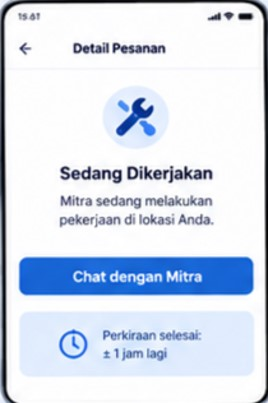

**Deskripsi :** Halaman yang menampilkan informasi 
bahwa Provider sedang melaksanakan pekerjaan sesuai 
permintaan Customer.

**Tujuan :** Memberi tahu ke Pelanggan bahwa pesanan 
sedang di kerjakan

---

### 19. Fitur Melihat Riwayat Pemesanan

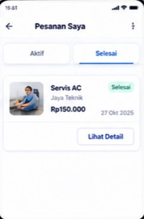

**Deskripsi:** Fitur ini memungkinkan Customer melihat 
daftar pemesanan yang pernah dilakukan sebelumnya 
melalui aplikasi Jasa Kita.

**Tujuan:** Memudahkan Customer mengetahui dan 
memeriksa kembali riwayat penggunaan layanan jasa.

### 20. Tampilan halaman Penilaian/Rating

**Deskripsi:** Fitur ini memungkinkan Customer memberikan 
penilaian berupa rating dan ulasan terhadap layanan yang 
telah diterima.

**Tujuan:** Memberikan evaluasi terhadap kualitas layanan 
serta membantu calon pelanggan lain mempertimbangkan 
penyedia jasa.
