## Customer (Pelanggan)

**23 fitur**

Customer merupakan pengguna yang telah memiliki akun dan melakukan login ke aplikasi Jasa 
Kita. Customer dapat mencari layanan, melakukan pemesanan, berkomunikasi dengan Provider, 
serta memberikan penilaian.

### 1. Halaman Splash Screen

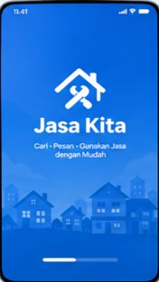

**Deskripsi:** Halaman awal yang ditampilkan ketika Customer membuka aplikasi Jasa Kita sebelum diarahkan ke halaman utama.

**Tujuan:** Memperkenalkan identitas aplikasi melalui tampilan logo dan nama Jasa Kita.

### 2. Fitur Mendaftar dan Login

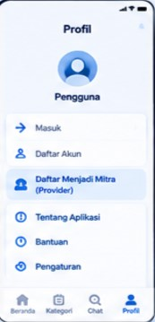

**Deskripsi:** Fitur ini memungkinkan Customer membuat akun baru atau masuk ke aplikasi menggunakan akun yang telah terdaftar.

**Tujuan:** Memberikan akses kepada Customer untuk menggunakan fitur aplikasi yang memerlukan autentikasi.

**Catatan:** Customer dapat masuk menggunakan alamat email atau nomor HP dan kata sandi. Pengguna yang belum memiliki akun dapat memilih menu Daftar Akun. Selain itu, tersedia pilihan Lupa Password untuk membantu pengguna yang lupa kata sandi.

---

### 3. Halaman Pendaftaran Akun

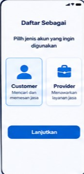

**Deskripsi:** Halaman yang memungkinkan pengguna melakukan pendaftaran akun baru sebagai Customer dengan mengisi informasi yang diperlukan, seperti nama lengkap, alamat email atau nomor HP, dan kata sandi.

**Tujuan:** Memfasilitasi pengguna untuk membuat akun Customer agar dapat mengakses fitur pemesanan jasa, komunikasi dengan Provider, dan pengelolaan aktivitas akun.

### 4. Verifikasi Akun

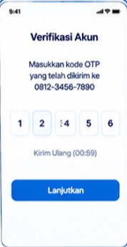

**Deskripsi:** Halaman yang menampilkan tahapan verifikasi identitas atau kode verifikasi yang dikirimkan kepada pengguna melalui metode verifikasi yang disediakan aplikasi.

**Tujuan:** Memastikan bahwa akun didaftarkan menggunakan informasi kontak yang valid serta membantu menjaga keamanan akun pengguna.

---

### 5. Pengisian Data Diri

**Deskripsi:** Halaman untuk melengkapi informasi pribadi Customer, seperti nama lengkap, nomor telepon, alamat, dan informasi pendukung lainnya.

**Tujuan:** Melengkapi profil Customer agar Provider dapat mengenali pelanggan dan mengetahui informasi yang diperlukan ketika menerima pesanan.

### 6. Fitur Beranda Customer

**Deskripsi:** Fitur ini memungkinkan Customer melihat berbagai 
kategori layanan jasa yang tersedia, seperti servis AC, teknisi 
listrik, bengkel, dan perbaikan rumah.

**Tujuan:** Memudahkan Customer menemukan kategori layanan 
sesuai kebutuhan.

**Catatan:** Halaman beranda menampilkan kolom pencarian, kategori jasa, serta rekomendasi penyedia jasa. Customer dapat mencari layanan melalui kategori yang tersedia atau melihat penyedia jasa yang direkomendasikan.

---

### 7. Daftar Kategori Jasa

**Deskripsi:** Fitur ini memungkinkan Customer melihat berbagai kategori layanan jasa yang tersedia, seperti servis AC, bengkel, teknisi listrik, tukang bangunan, dan perbaikan rumah.

**Tujuan:** Membantu Customer mengetahui jenis layanan yang dapat ditemukan melalui aplikasi Jasa Kita.

### 8. Fitur Mencari Penyedia Jasa Berdasarkan Nama atau Kategori

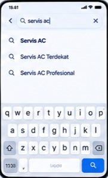

**Deskripsi:** Fitur ini memungkinkan Customer mencari penyedia 
jasa menggunakan nama mitra atau kategori layanan tertentu 
melalui fitur pencarian.

**Tujuan:** Mempermudah Customer menemukan penyedia jasa 
yang sesuai tanpa harus mencari satu per satu secara manual.

**Catatan:** Customer dapat mencari layanan atau nama Provider melalui kolom pencarian. Hasil pencarian dapat disaring berdasarkan kategori dan lokasi agar daftar penyedia jasa yang ditampilkan lebih relevan dengan kebutuhan Customer.

---

### 9. Tampilan Fitur Memfilter Penyedia Jasa Berdasarkan Lokasi

**Deskripsi:** Fitur ini memungkinkan Customer menyaring daftar 
penyedia jasa berdasarkan lokasi untuk menemukan mitra yang 
berada di sekitar lokasi yang dibutuhkan.

**Tujuan:** Membantu Customer menemukan penyedia jasa yang 
lokasinya sesuai dengan kebutuhan pekerjaan.

### 10. Tampilan Fitur Memasukkan Detail Kebutuhan dan Lokasi Pekerjaan

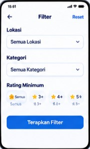

**Deskripsi:** Fitur ini memungkinkan Customer memasukkan 
informasi mengenai kebutuhan pekerjaan serta lokasi tempat 
layanan akan dilakukan.

**Tujuan:** Membantu Provider memahami jenis pekerjaan dan 
mengetahui lokasi pekerjaan sebelum menerima pesanan.

---

### 11. Fitur Melihat Profil dan Informasi Layanan Mitra

**Deskripsi:** Fitur ini memungkinkan Customer melihat informasi profil Provider, seperti identitas mitra, lokasi layanan, jam operasional, serta jenis layanan jasa yang ditawarkan.

**Tujuan:** Memberikan informasi yang cukup kepada Customer agar dapat mempertimbangkan dan memilih Provider yang sesuai sebelum melakukan pemesanan.

### 12. Fitur Membuat Pemesanan Jasa

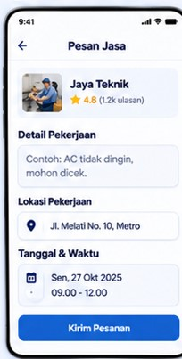

**Deskripsi:** Fitur ini memungkinkan Customer mengirimkan permintaan pemesanan layanan kepada Provider yang telah dipilih melalui aplikasi dengan mengisi detail kebutuhan pekerjaan, lokasi, dan jadwal layanan.

**Tujuan:** Mempermudah Customer melakukan pemesanan jasa serta membantu Provider memahami kebutuhan pekerjaan sebelum menerima pesanan.

**Contoh kebutuhan pekerjaan:** AC tidak dingin, mohon dicek.

---

### 13. Konfirmasi Pesanan Berhasil Dibuat

**Deskripsi:** Halaman yang menampilkan konfirmasi bahwa permintaan pemesanan jasa berhasil dikirim oleh Customer. Halaman ini menampilkan informasi layanan, detail kebutuhan pekerjaan, jadwal, lokasi, Provider yang dipilih, dan status pesanan.

**Tujuan:** Memberikan kepastian kepada Customer bahwa permintaan pemesanan telah berhasil dicatat oleh sistem dan sedang menunggu tanggapan dari Provider.

### 14. Status Pesanan Menunggu Proses Provider

**Deskripsi:** Halaman yang menampilkan informasi status pesanan Customer yang masih menunggu pemeriksaan dan tanggapan dari Provider.

**Tujuan:** Memudahkan Customer mengetahui perkembangan permintaan pemesanan sebelum Provider menerima atau menolak pesanan.

---

### 15. Fitur Mengirim Pesan kepada Mitra melalui Chat

**Deskripsi:** Fitur ini memungkinkan Customer 
berkomunikasi secara langsung dengan Provider 
melalui fitur chat untuk membahas kebutuhan dan 
detail pekerjaan.

**Tujuan:** Mempermudah komunikasi antara Customer 
dan Provider agar informasi pekerjaan dapat 
disampaikan dengan jelas.

### 16. Fitur Membatalkan Pesanan Sesuai Ketentuan

**Deskripsi:** Fitur ini memungkinkan Customer 
membatalkan permintaan pemesanan apabila tidak 
jadi menggunakan layanan, dengan mengikuti 
ketentuan yang berlaku.

**Tujuan:** Memberikan fleksibilitas kepada Customer 
apabila terjadi perubahan kebutuhan terhadap 
layanan yang telah dipesan.

---

### 17. Pesanan Diterima Provider

**Deskripsi:** Halaman yang menampilkan informasi bahwa permintaan pemesanan Customer telah diterima oleh Provider.

**Tujuan:** Memberikan informasi kepada Customer bahwa Provider telah menyetujui permintaan pemesanan dan akan melaksanakan pekerjaan sesuai detail pesanan.

### 18. Fitur Melihat Status Pekerjaan

**Deskripsi:** Fitur ini memungkinkan Customer melihat informasi perkembangan pekerjaan yang sedang dilakukan oleh Provider sesuai dengan permintaan pemesanan.

**Tujuan:** Memudahkan Customer memantau proses pengerjaan dan mengetahui status layanan yang sedang berlangsung.

### 19. Halaman Konfirmasi Penyelesaian Pekerjaan

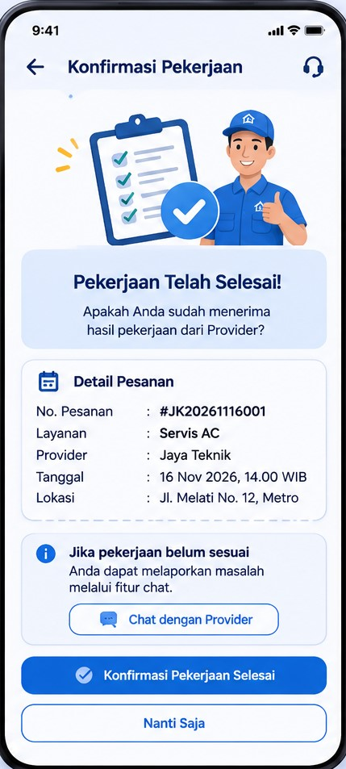

**Deskripsi:** Halaman yang menampilkan informasi bahwa Provider telah menyelesaikan pekerjaan. Customer dapat memeriksa hasil pekerjaan dan memberikan konfirmasi apabila layanan telah selesai dilakukan.

**Tujuan:** Memastikan bahwa pekerjaan telah diselesaikan sesuai permintaan Customer sebelum melanjutkan ke proses pembayaran.

### 20. Halaman Pembayaran Pesanan

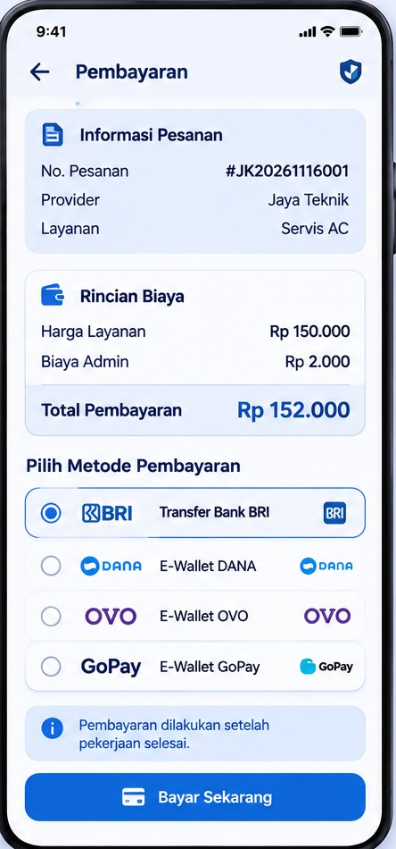

**Deskripsi:** Halaman yang menampilkan rincian tagihan layanan setelah Customer mengonfirmasi bahwa pekerjaan telah selesai. Customer dapat melihat total biaya dan memilih metode pembayaran online yang tersedia.

**Tujuan:** Memudahkan Customer menyelesaikan pembayaran layanan melalui aplikasi Jasa Kita secara praktis dan aman.

### 21. Halaman Status Pembayaran

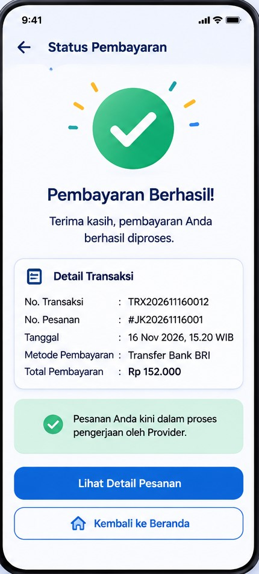

**Deskripsi:** Halaman yang menampilkan informasi hasil pembayaran Customer, seperti pembayaran berhasil, menunggu konfirmasi, atau pembayaran gagal. Halaman ini juga menampilkan detail transaksi sebagai bukti pembayaran.

**Tujuan:** Memberikan informasi kepada Customer mengenai status transaksi serta memastikan pembayaran dapat dipantau melalui aplikasi Jasa Kita.

### 22. Fitur Melihat Riwayat Pemesanan

**Deskripsi:** Fitur ini memungkinkan Customer melihat 
daftar pemesanan yang pernah dilakukan sebelumnya 
melalui aplikasi Jasa Kita.

**Tujuan:** Memudahkan Customer mengetahui dan memeriksa kembali riwayat penggunaan layanan jasa, termasuk status pesanan dan pembayaran..

### 23. Halaman Penilaian dan Rating

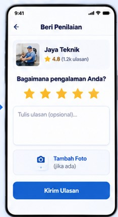

**Deskripsi:** Fitur ini memungkinkan Customer memberikan penilaian berupa rating dan ulasan terhadap layanan yang telah diselesaikan dan pembayarannya telah dikonfirmasi berhasil.

**Tujuan:** Memberikan evaluasi terhadap kualitas layanan serta membantu calon Customer lain dalam mempertimbangkan penyedia jasa.
